# Guida — Amministratore

L'Admin ha accesso completo: oltre a tutte le funzioni di gestione (vedi la
[guida della Segreteria](segreteria.md) e quella dell'[Incaricato EG](incaricato.md)) configura la
piattaforma, l'accesso, Google Drive e la posta, segue i PDF e aggiorna il server dal web.

> Per l'Admin la **verifica in due passaggi** è sempre obbligatoria (salvo accesso con SSO AGESCI
> Campania, dove la chiede l'SSO).

---

## Il menu Sistema

Oltre a *Gestione* (Edizioni, Utenti, Inviti, Import, Statistiche), l'Admin trova nel menu la
sezione **Sistema**:

| Voce | Cosa contiene |
|---|---|
| **Impostazioni** | Le impostazioni della piattaforma, divise in schede |
| **Cache PDF** | PDF già generati, invalidazione e generazione massiva |
| **Log export** | Storico della generazione di PDF ed Excel, con gli errori |
| **Aggiornamenti** | Versione del server e aggiornamento dal web |
| **Pannello admin** | L'amministrazione Django (`/admin/`), per interventi di basso livello |
| **Attività in background** | I lavori che Plancia fa dietro le quinte (PDF, email in blocco, export, controllo aggiornamenti): in corso, riusciti, falliti. È il pannello Flower di Celery, in inglese. Compare solo se il servizio è attivo (sotto) |
| **Mailpit** | Le email intercettate in modalità di prova. Compare solo se il servizio è attivo |

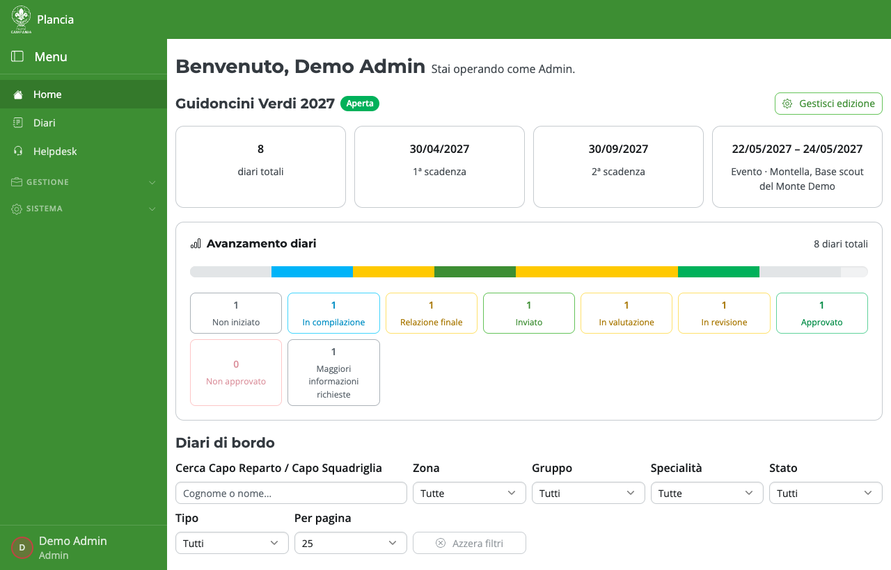

Attività in background e Mailpit sono servizi facoltativi: si attivano sul server con
`COMPOSE_PROFILES=flower,mailpit` (uno o tutti e due) nel file `.env`, poi `docker compose up -d`.
Senza, voci e pulsanti non compaiono.

Pannello admin, Attività in background e Mailpit si aprono in una nuova scheda con la stessa sessione di Plancia
(senza sessione portano alla pagina di accesso). Usa il Pannello admin solo per emergenze non
gestibili dall'app.

---

## Impostazioni

La pagina **Impostazioni della piattaforma** ha sei schede; ogni riquadro ha il proprio pulsante
di salvataggio.

### Identità e footer

**Titolo** e **Sottotitolo** della piattaforma; **Testo del footer**, con l'editor (*Visuale*,
*HTML*, *Anteprima*) e le variabili `{{ titolo }}`, `{{ sottotitolo }}`, `{{ versione }}`,
`{{ commit }}`; **Link del footer** (fino a 4, con tipo, etichetta e indirizzo, riordinabili). Il
link al manuale e quelli alle pagine legali compaiono da soli.

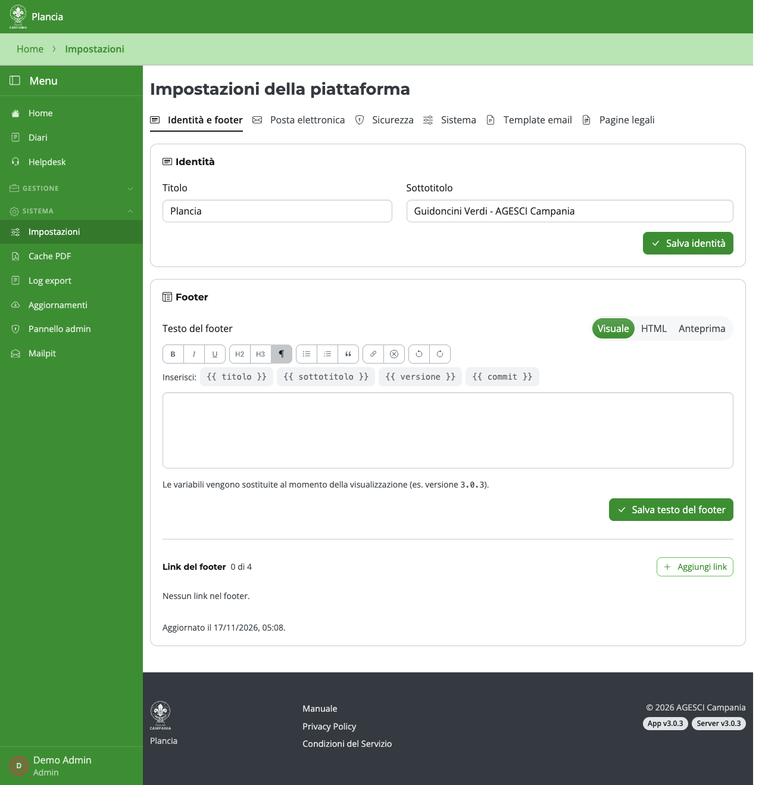

### Posta elettronica

- **Modalità invio mail**: *Invio reale*, *Simulato (solo log su file)*, *Simulato + invio reale*,
  *Mailpit*.
- **Nome mittente** e **Mittente (from)**.
- **Backend email standard** (email di sistema: reset password, verifica, notifiche singole) e
  **Backend invii massivi** (inviti in blocco): SMTP o provider transazionale.
- **Backend SMTP**: host, porta, TLS, utente e password; in alternativa **Gmail OAuth2**
  (**Collega Gmail** / **Scollega**, vedi sotto). Se il relay SMTP rifiuta il nome con cui
  Plancia si presenta (EHLO), il nome del server va nella variabile `EMAIL_EHLO` del `.env`.
- **Backend provider transazionale** (Brevo, Mailgun…): provider, API key, webhook secret e
  l'URL del webhook da configurare nel provider (serve a tracciare consegne e rimbalzi).
- **Salva posta elettronica**, poi **Test SMTP** / **Test provider transazionale** inviano una mail
  di prova al tuo indirizzo (ignorando la modalità simulata).

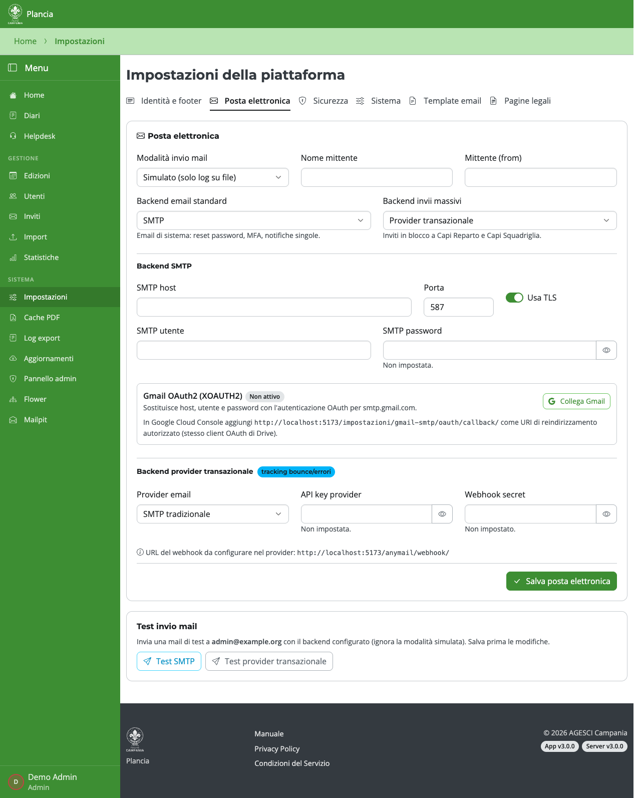

Guida completa: **[Configurazione email](../guide/email_provider.md)**.

**Gmail OAuth2 SMTP.** Per usare Gmail senza password: nel client OAuth di Google Cloud (lo stesso
di Drive) aggiungi come URI di reindirizzamento
`https://plancia.agescicampania.net/impostazioni/gmail-smtp/oauth/callback/` (la pagina mostra
l'indirizzo esatto), poi premi **Collega Gmail** e autorizza l'account da cui inviare. Il token si
rinnova da solo.

### Sicurezza

- **MFA obbligatoria per Segreteria e Incaricati EG**: attiva per impostazione predefinita;
  spegnendola la verifica in due passaggi resta obbligatoria solo per gli Admin.
- **Protezione dai tentativi di accesso**: *Tentativi prima del blocco*, *Minuti di blocco
  automatico* (0 = blocco permanente fino allo sblocco), *Scadenza dei tentativi*.
- **IP bloccati**: elenco con **Sblocca** e **Sblocca tutti**.

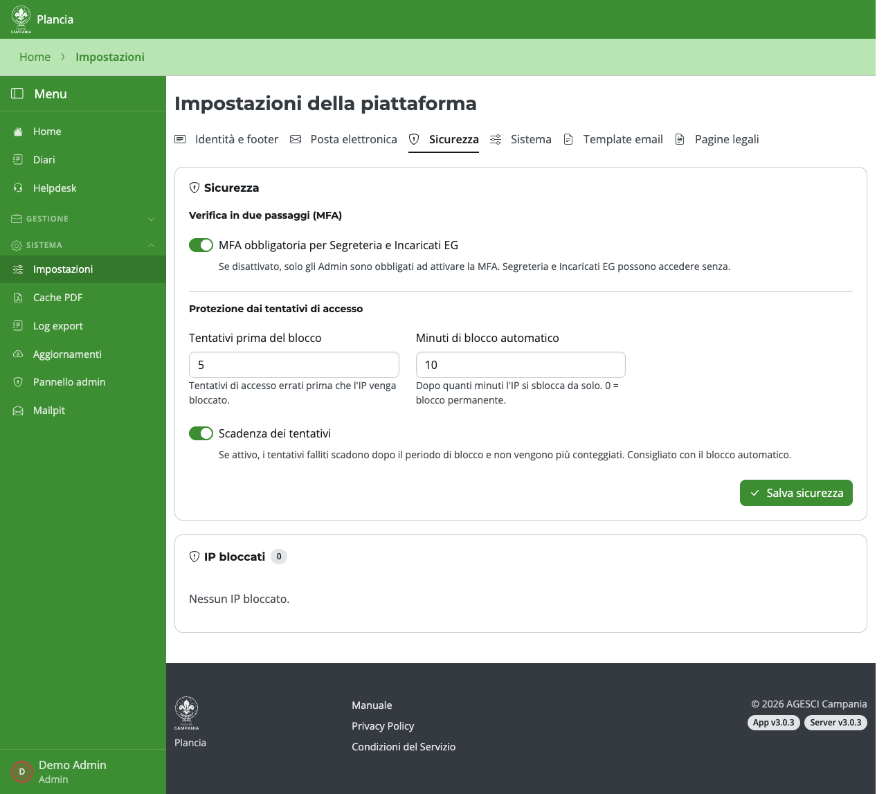

### Sistema

- **Allegati**: *Lato maggiore delle immagini (px)*; le foto caricate vengono ridotte a questa
  misura (JPEG qualità 85); nel PDF entrano a 480 px.
- **Stato e diagnostica**: **Modalità manutenzione** con il messaggio da mostrare (solo gli Admin
  possono usare Plancia: chi ha il ruolo Admin attivo, anche da SSO, e i superuser; l'accesso
  resta aperto a tutti, ma gli altri vedono il messaggio in cima alla pagina e non possono
  lavorare), **Debug toolbar**,
  **Log diagnostico**; collegamenti ad Attività in background e Mailpit.
- **Strumenti**: collegamenti a Cache PDF, Log export, Google Drive, Aggiornamenti del server e
  Import tracciati.

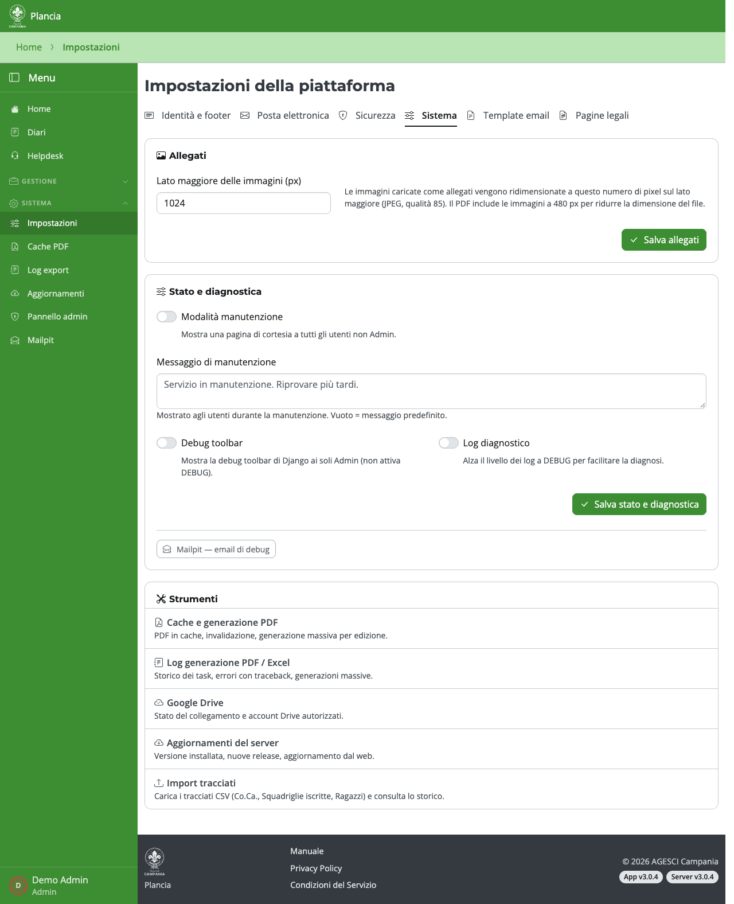

### Template email

L'elenco delle email automatiche (inviti, reset password, notifiche…) con i **tag** disponibili
(tra doppie graffe, sostituiti all'invio). Senza personalizzazione si usa il file predefinito.
**Modifica** apre l'editor (*Oggetto email*, *Attivo*, *Corpo HTML*, **Salva template**);
**Importa da file** parte dal predefinito; **Crea nuovo** / **Crea nuovo da attuale** duplica un
template su un'altra chiave; **Elimina (ripristina predefinito)** torna al file.

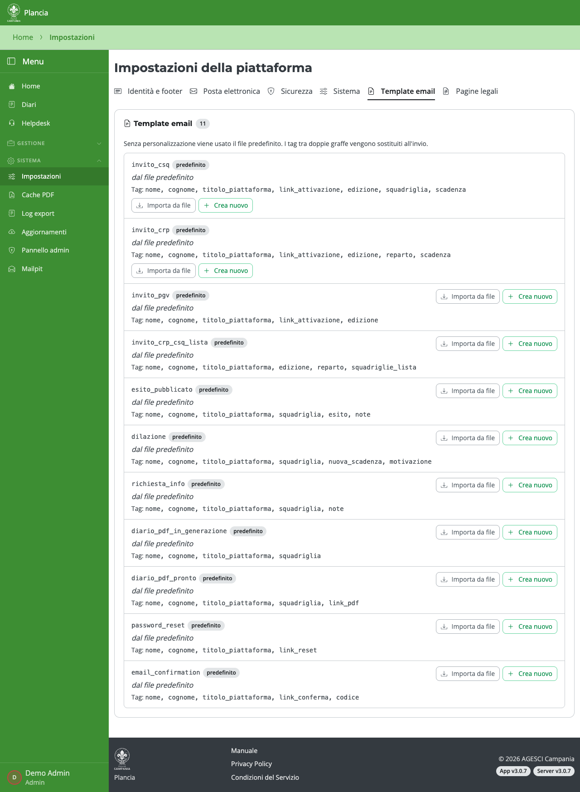

### Pagine legali

**Privacy Policy** e **Condizioni del Servizio**, pubblicate su `/pagine/<nome>` e linkate nel
piè di pagina: **Visualizza**, **Predefinito** (carica il testo di partenza fornito dalla
piattaforma: **personalizzalo prima di pubblicarlo**) e **Modifica** (*Titolo*, *Contenuto*,
**Salva**).

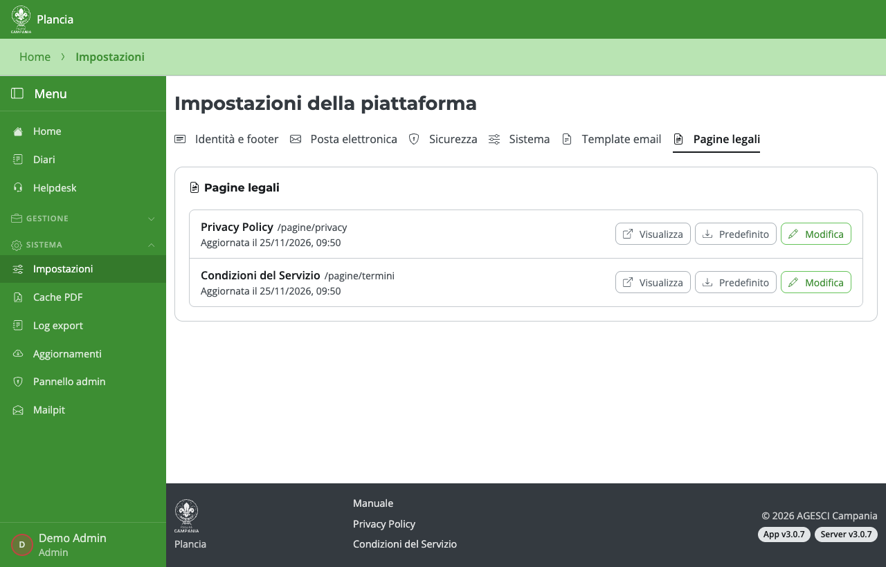

---

## Accesso con SSO AGESCI Campania (Sestante)

Il pulsante **Accedi con SSO AGESCI Campania** usa l'account regionale di
`https://auth.agescicampania.net`. Compare solo quando nel file `.env` del server sono valorizzati
`SOCIAL_SESTANTE_CLIENT_ID` e `SOCIAL_SESTANTE_CLIENT_SECRET` (si trovano in
<https://auth.agescicampania.net/if/admin/#/core/providers> → **Plancia AGESCI Campania** →
modifica; dopo averli inseriti: `docker compose up -d`). Guida tecnica:
[SSO Sestante](../guide/sso_sestante.md).

Al login con SSO:

- l'account Plancia con la stessa email viene **collegato**; se non esiste viene **creato** senza
  ruoli locali;
- i gruppi dell'SSO `admin-multipiattaforma` e `segreteria` danno i ruoli **Admin** e
  **Segreteria** in Plancia, aggiornati a ogni accesso (tolti nell'SSO → revocati qui). I ruoli
  assegnati in Plancia non vengono mai toccati;
- la **verifica in due passaggi** la chiede l'SSO: Plancia non la richiede a chi è entrato con SSO,
  ma continua a richiederla a chi entra con email e password;
- account SSO senza email, o email usata da più account Plancia: l'accesso viene rifiutato con un
  messaggio nella pagina di accesso. In caso di doppioni unifica gli account prima di riprovare.

Il login con email e password resta disponibile accanto all'SSO.

---

## Accesso con Google, Microsoft e Apple

Per i pulsanti *Accedi con Google / Microsoft / Apple* segui la guida
**[Autenticazione social](../guide/social_auth.md)**. In sintesi:

1. crea le credenziali OAuth presso il provider con redirect URI
   `https://plancia.agescicampania.net/accounts/<google|microsoft|apple>/login/callback/`;
2. imposta le variabili nel `.env` del server (`SOCIAL_GOOGLE_CLIENT_ID`,
   `SOCIAL_GOOGLE_CLIENT_SECRET`, …);
3. applica con `docker compose up -d`. I pulsanti compaiono solo per i provider configurati.

> I provider social **non creano nuovi utenti**: l'email deve corrispondere a un account già
> esistente. Solo l'SSO AGESCI Campania crea gli account mancanti.

---

## Google Drive

Plancia può archiviare foto e PDF dei diari su **Google Drive**. Serve un client OAuth separato
da quello del login con Google (gli scope sono diversi):

| Scopo | Variabili | Scope |
|---|---|---|
| Login con Google | `SOCIAL_GOOGLE_CLIENT_ID/SECRET` | `email`, `profile`, `openid` |
| Google Drive | `GOOGLE_OAUTH_CLIENT_ID/SECRET`, `GOOGLE_OAUTH_REDIRECT_URI` | `drive` |

### 1. Credenziali

In [Google Cloud Console](https://console.cloud.google.com): abilita la **Google Drive API**, crea
un **ID client OAuth 2.0** di tipo *Applicazione web* con URI di reindirizzamento
`https://plancia.agescicampania.net/drive/oauth/callback/` (in sviluppo
`http://localhost:8000/drive/oauth/callback/`) e metti ID e secret nel `.env`:

```bash
GOOGLE_OAUTH_CLIENT_ID=xxxxx.apps.googleusercontent.com
GOOGLE_OAUTH_CLIENT_SECRET=GOCSPX-xxxxx
GOOGLE_OAUTH_REDIRECT_URI=https://plancia.agescicampania.net/drive/oauth/callback/
```

Guida completa: **[Google Drive OAuth](../guide/google_drive_oauth.md)**.

### 2. Collegare l'account

Da **Impostazioni → Sistema → Google Drive** (pagina *Google Drive*) premi **Collega un account
Google Drive** e autorizza l'account Google che contiene le cartelle. La pagina elenca gli
**Account collegati** (*Attivo* o *Autorizzazione scaduta*: in quel caso ripeti il collegamento
con lo stesso account). Conviene un account dedicato (es. `archivio@…`) per non esporre file
personali.

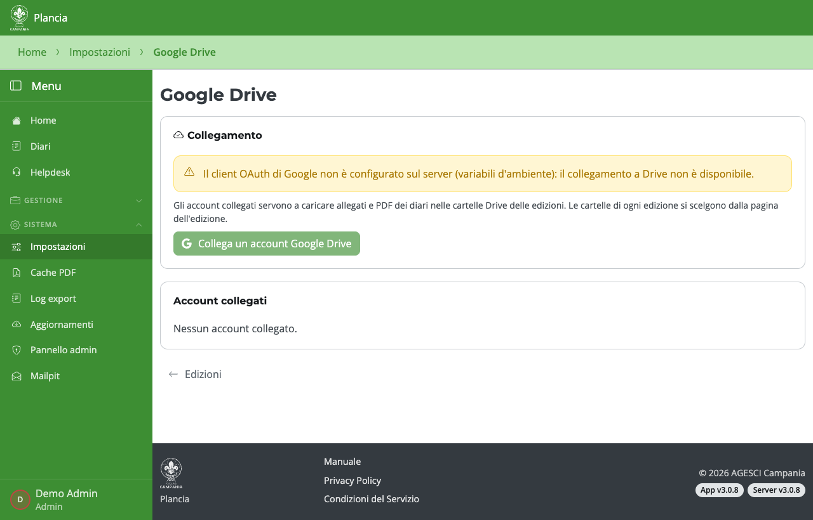

### 3. Cartelle dell'edizione

Nella pagina dell'edizione, riquadro **Google Drive**:

1. **Connetti account Google Drive** (o **Cambia account Drive**);
2. **Cartella Allegati** e **Cartella Output**: incolla l'ID o premi **Sfoglia** per sceglierla;
3. **Formato nome cartella diario**, con l'anteprima. Variabili: `{id_univoco}` (obbligatoria,
   5 cifre), `{edizione}`, `{nome_gruppo}`, `{nome_zona}`, `{nome_reparto}`, `{nome_squadriglia}`,
   `{specialita}`. Predefinito:
   `{id_univoco}_{edizione}_{nome_gruppo}_{nome_reparto}_{nome_squadriglia}_{specialita}`;
4. **Salva e blocca configurazione**.

> **Configurazione irreversibile**: con le due cartelle e il formato salvati la configurazione si
> blocca. Le sottocartelle di ogni diario vengono create al primo caricamento di una foto o di un
> PDF; cambiando il nome della squadriglia nell'anagrafica vengono rinominate.

---

## PDF dei diari

### Cache PDF

**Cache PDF** elenca per ogni edizione i PDF già generati (squadriglia, nome del file, dimensione,
data, link a Drive), con l'eliminazione del singolo PDF, **Invalida tutti** per l'edizione e
**Invalida tutta la cache PDF**.

**Genera tutti i PDF di un'edizione**: scegli l'**Edizione** e premi **Avvia generazione
massiva**. Il server genera i PDF di tutti i diari inviati, li carica su Drive e manda un
aggiornamento per email ogni 10 diari; una barra mostra l'avanzamento e **Interrompi** la ferma
dopo il diario in corso. Durante la generazione i PDF singoli di quell'edizione sono sospesi.

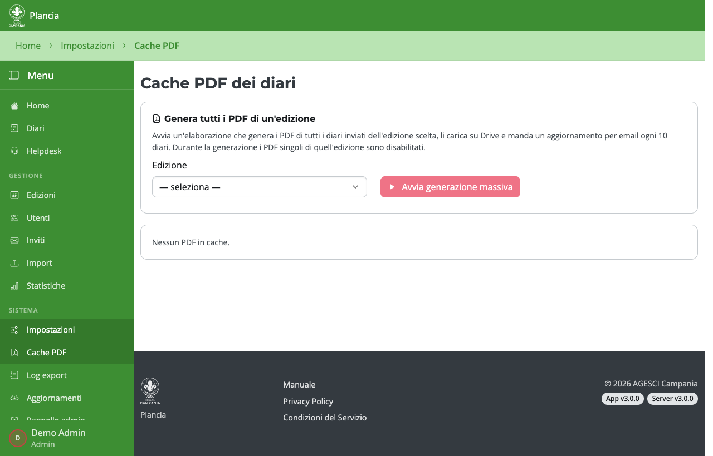

### Log export

**Log export** è lo storico delle generazioni di PDF ed Excel: data, tipo, stato, diario o
edizione, utente e messaggio; per gli errori il **Traceback** completo. Gli errori arrivano anche
per email al richiedente e agli Admin.

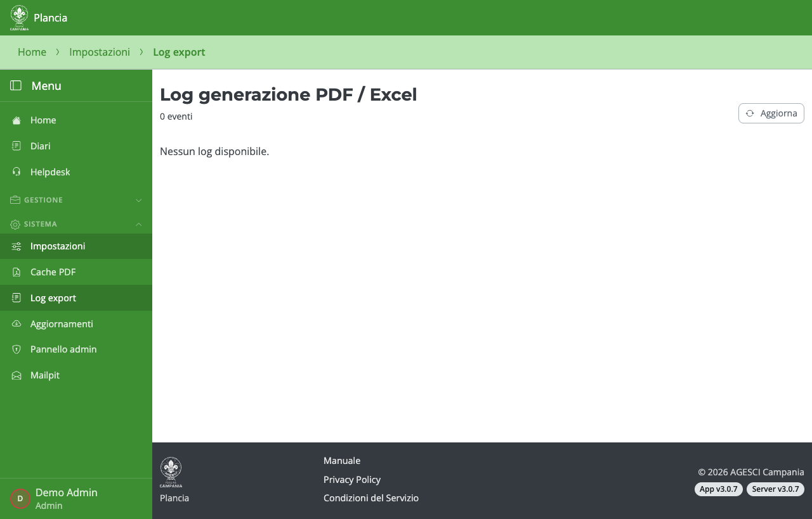

---

## Aggiornare il server dal web

**Aggiornamenti** mostra la **Versione installata**, l'**Ultima release** pubblicata su GitHub
(con le novità) e l'**Ultimo controllo**; **Controlla ora** ripete il controllo.

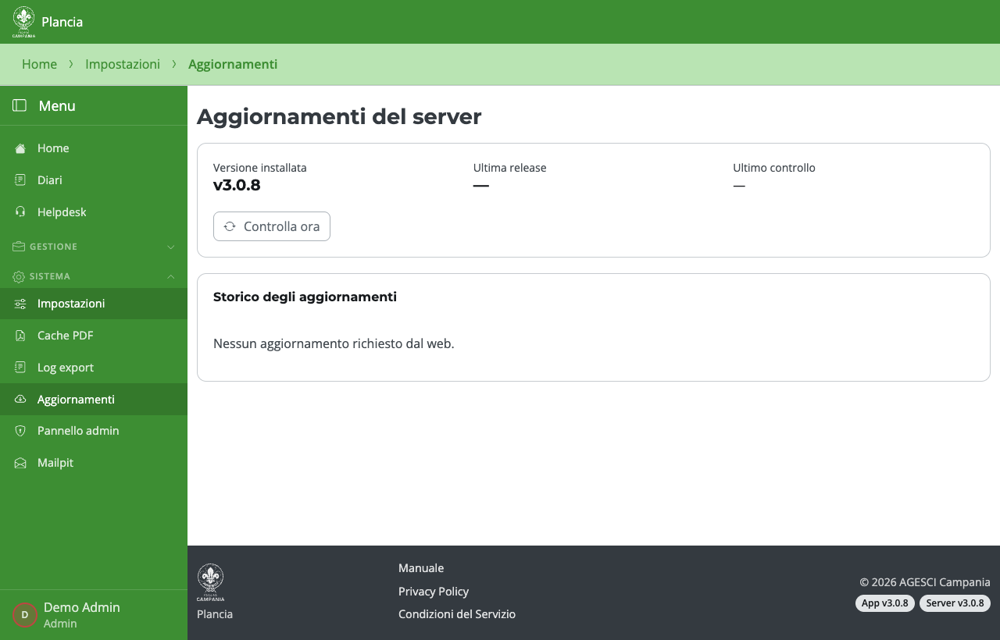

Quando c'è una versione nuova:

1. premi **Aggiorna a vX.Y.Z** e conferma: Plancia andrà in manutenzione per qualche minuto
   (backup, costruzione e riavvio); ti viene chiesto di confermare la tua identità;
2. la pagina segue l'avanzamento (fasi, percentuale e **Log dell'aggiornamento**), anche durante
   il riavvio del server, quando Plancia per qualche istante non risponde;
3. a fine aggiornamento l'app si ricarica da sola, appena il server serve di nuovo le pagine. Se qualcosa va storto il server torna alla
   versione precedente; l'Admin riceve comunque un'email con l'esito e il log completo resta sul
   server in `aggiornamenti/log/`.

Finché il server non ha preso in carico la richiesta, **Annulla la richiesta** la ritira. Lo
**Storico degli aggiornamenti** elenca le richieste fatte dal web con esito e log.

Dopo l'aggiornamento del server gli utenti vedono la finestra **Aggiornamento disponibile** per
aggiornare l'app sul proprio dispositivo (vedi la [panoramica](index.md#aggiornamenti-dellapp)).

---

## Archiviazione di un'edizione

Al termine dell'edizione, dal server:

```bash
# Genera i PDF di tutti i diari e l'Excel degli esiti e li carica su Drive
docker compose exec web python manage.py archivia_edizione --edizione 1 --genera

# (Dopo la verifica) elimina le foto e segna l'edizione come archiviata
docker compose exec web python manage.py archivia_edizione --edizione 1 --purga --conferma
```

`--purga` elimina fisicamente le foto (dati di minori) mantenendo i link esterni come testo; PDF
ed Excel restano su Drive.

---

## Backup

Ogni notte alle 02:30 il server esegue `scripts/backup.sh` (timer `plancia-backup.timer`): un
archivio con dump del database, file `.env` e allegati non ancora caricati su Drive, nella
cartella `backups/`, conservato 14 giorni (`BACKUP_DIR` e `BACKUP_GIORNI` in `.env`). Ogni
aggiornamento salva anche un dump del database. Stato: `systemctl status plancia-backup.timer`.

---

## Per gli sviluppatori: rigenerare gli screenshot del manuale

Gli screenshot di questo manuale (`docs/manuale/screenshots/`) si rigenerano con Playwright
contro uno stack locale, su dati **sintetici**:

```bash
# 1. dati dimostrativi (idempotente; --ricrea riporta i diari allo stato iniziale)
uv run python manage.py popola_demo --password 'Demo-Plancia-2027' --disattiva-rate-limit --ricrea
# 2. Django in sviluppo (DEBUG: codice di verifica 000000) e la SPA
uv run python manage.py runserver
cd frontend && npm run dev
# 3. gli screenshot (tutti, o solo alcuni gruppi: comune csq crp pgv incaricato segreteria admin)
PLANCIA_DEMO_PASSWORD='Demo-Plancia-2027' npm run manuale:schermate
PLANCIA_DEMO_PASSWORD='Demo-Plancia-2027' npm run manuale:schermate -- csq crp
```

Lo script è `frontend/scripts/schermate-manuale.ts` (eseguito direttamente da Node); usa
`PLANCIA_MANUALE_URL` se la SPA non è su `http://localhost:5173`. Su macOS la generazione dei PDF
richiede le librerie di WeasyPrint (es. `DYLD_FALLBACK_LIBRARY_PATH=/opt/homebrew/lib` per
Django). Il PDF del manuale si genera con `make manual`; alla pubblicazione di una release il
workflow `release-manual.yml` allega i PDF alla release.
