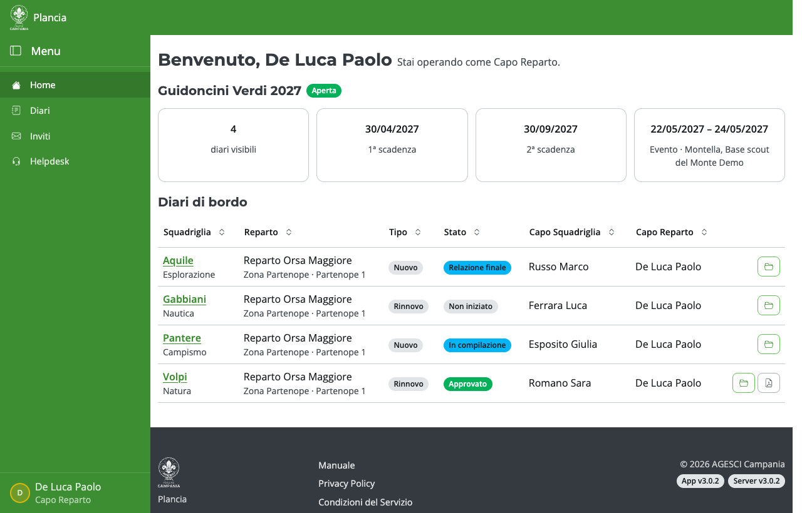
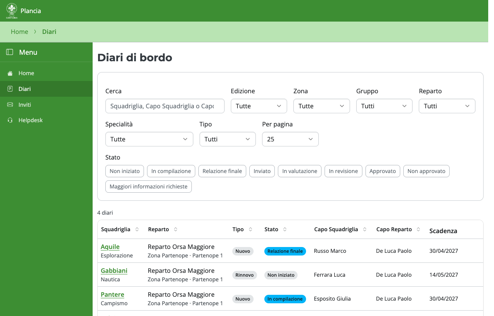
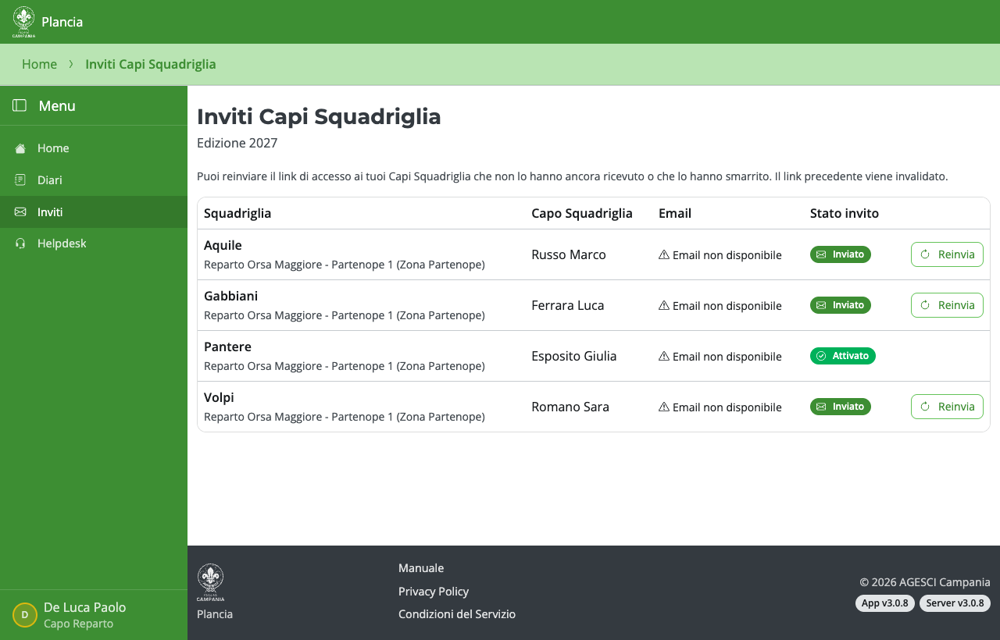
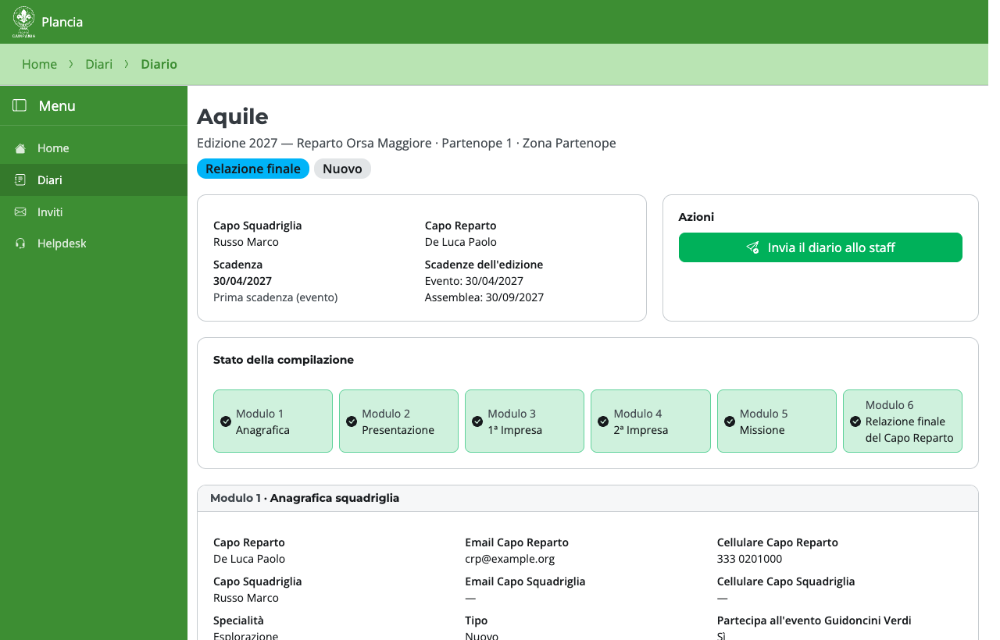
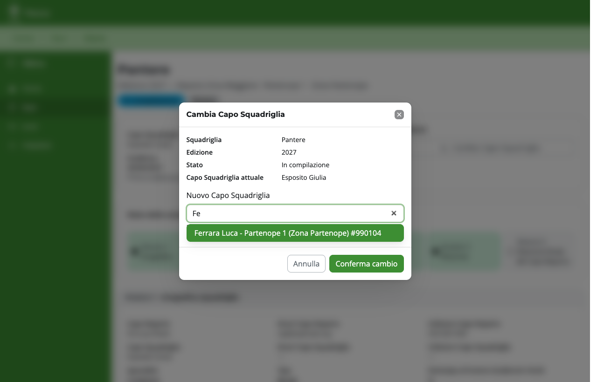
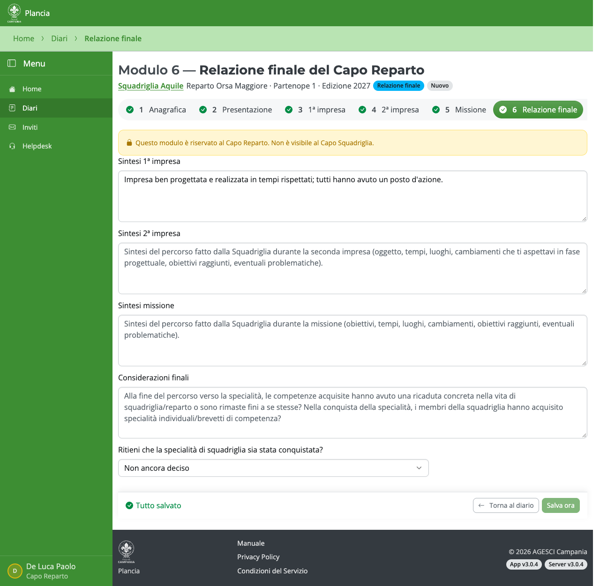
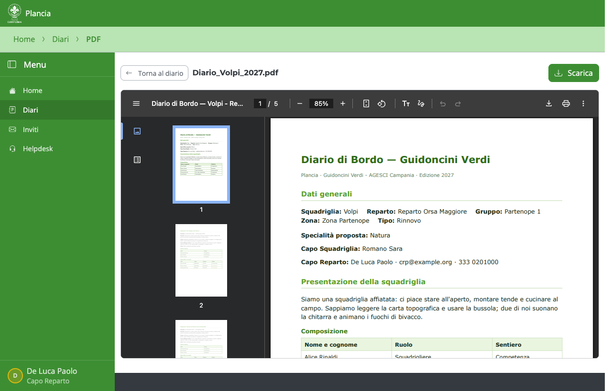
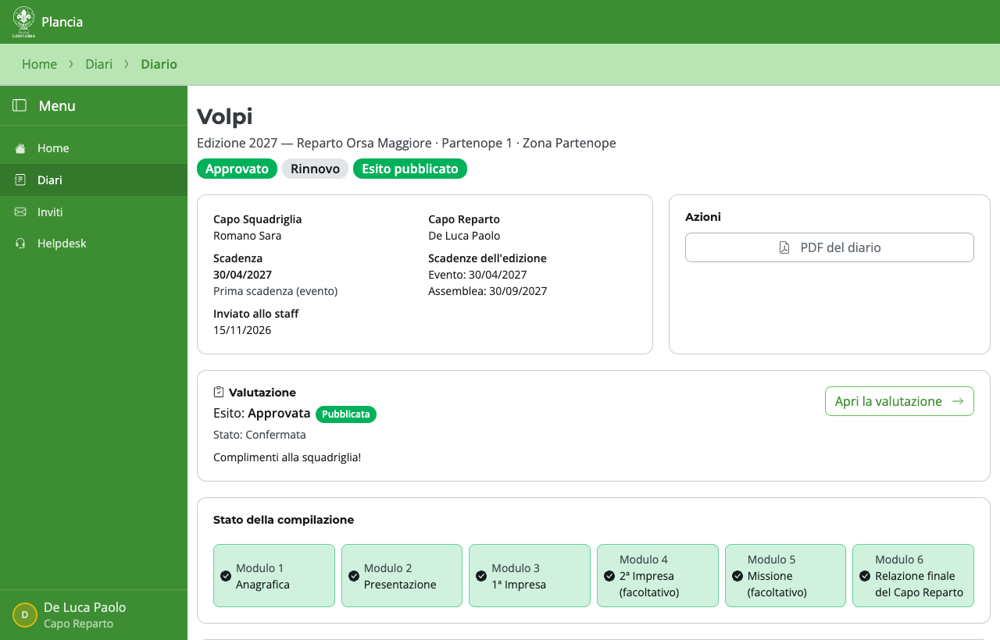

# Guida — Capo Reparto

Il Capo Reparto segue i diari delle squadriglie del proprio reparto: ne legge tutti i moduli,
consegna ai Capi Squadriglia i link di attivazione e compila, in esclusiva, il **Modulo 6 —
Relazione finale**, che il Capo Squadriglia non vede mai. Infine invia il diario allo staff.

---

## Primo accesso

La Segreteria regionale ti invia un'email con il link personale di attivazione. Aprilo: la
pagina di attivazione ti fa entrare (o, se hai già credenziali tue, ti rimanda alla pagina di
accesso). Da quel momento puoi entrare con la tua email e la password, scelta dal menu utente →
**Password e sicurezza** (o con **Password dimenticata?** dalla pagina di accesso), oppure con
**Accedi con SSO AGESCI Campania** se hai l'account regionale.

---

## Home e lista dei diari

La home mostra l'edizione in corso (diari visibili, 1ª e 2ª scadenza, date e luogo dell'evento) e
la tabella dei diari del tuo reparto, con stato, Capo Squadriglia e Capo Reparto.

La voce **Diari** del menu apre l'elenco completo, con ricerca (squadriglia, Capo Squadriglia o
Capo Reparto), filtri per edizione, zona, gruppo, reparto, specialità, tipo e stato
(selezionabili insieme), ordinamento cliccando sulle colonne e paginazione. Sul telefono i diari
sono schede e i filtri si aprono con il pulsante **Filtri**. L'icona PDF a destra apre il PDF del
diario, quando è disponibile.

---

## Distribuire i link ai Capi Squadriglia

Quando la Segreteria invia gli inviti ai Capi Squadriglia ricevi un'**email riepilogativa** con
la tabella dei tuoi Capi Squadriglia e il link personale di ciascuno. **Il tuo compito è
consegnare a ognuno il proprio link**: di persona all'incontro di reparto (il modo più sicuro),
in chat o stampando la tabella. Il Capo Squadriglia lo apre e conferma il proprio **codice socio
AGESCI** e la propria email: così l'account viene attivato dalla persona giusta.

Dalla voce **Inviti** del menu (pagina *Inviti Capi Squadriglia*) vedi, per ogni squadriglia,
il Capo Squadriglia, l'email (se nota) e lo **Stato invito** (*Inviato*, *Attivato*…).
Con **Reinvia** mandi un nuovo link a chi non l'ha ricevuto o l'ha perso: il link precedente
smette di funzionare.

---

## Il diario della squadriglia

Aprendo un diario trovi lo stato, i referenti, la scadenza, il riquadro **Azioni**, lo **Stato
della compilazione** di ogni modulo e sotto il contenuto dei moduli 1–5 (e del modulo 6 quando
c'è).

Le azioni disponibili dipendono dallo stato:

| Stato | Azioni del Capo Reparto |
|---|---|
| Non iniziato, In compilazione | **Cambia Capo Squadriglia** |
| Relazione finale | Compila il modulo 6, **Invia il diario allo staff** |
| Inviato e successivi | **PDF del diario** |

---

## Cambiare il Capo Squadriglia

Se il Capo Squadriglia deve essere sostituito (per esempio lascia la squadriglia) puoi farlo
finché il diario è *Non iniziato* o *In compilazione*:

1. apri il diario e premi **Cambia Capo Squadriglia**;
2. nella finestra, nel campo **Nuovo Capo Squadriglia**, scrivi almeno 2 caratteri (nome,
   cognome, codice socio o gruppo) e scegli il ragazzo dall'elenco;
3. premi **Conferma cambio**.

Il precedente Capo Squadriglia perde l'accesso al diario; il nuovo lo vede nella propria home
dopo aver attivato l'account. Dopo l'invio della parte del Capo Squadriglia il cambio lo può fare
solo lo staff: apri un ticket all'Helpdesk.

---

## Modulo 6 — Relazione finale

Il modulo si compila quando il Capo Squadriglia ha premuto **Invia al Capo Reparto** e il diario
è in stato *Relazione finale*. Lo apri dal riquadro *Modulo 6* del diario o dalla barra dei
moduli. L'avviso in cima ricorda che il modulo è riservato al Capo Reparto.

Compila:

- **Sintesi 1ª impresa**: il percorso della squadriglia (oggetto, tempi, luoghi, cambiamenti
  rispetto al progetto, obiettivi raggiunti, problemi);
- **Sintesi 2ª impresa** e **Sintesi missione**, se presenti;
- **Considerazioni finali**: le competenze acquisite hanno avuto una ricaduta concreta? I membri
  hanno conquistato specialità o brevetti?
- **Ritieni che la specialità di squadriglia sia stata conquistata?** — *Sì*, *No* o *Non ancora
  deciso*.

Come tutti i moduli, la Relazione finale si **salva da sola** (barra in fondo: *Salvato alle …*,
**Salva ora**) e si può compilare anche offline: vedi
[Uso senza connessione](index.md#uso-senza-connessione).

> La Relazione finale non è mai visibile al Capo Squadriglia. Fino all'invio puoi anche eliminare
> le foto allegate alle imprese e alla missione.

---

## Inviare il diario allo staff

Quando la Relazione finale è pronta premi **Invia il diario allo staff** nel riquadro Azioni e
conferma. Il diario passa in stato *Inviato* e non è più modificabile (salvo riapertura da parte
dello staff).

---

## Il PDF del diario

Dal diario inviato (o dall'icona PDF nell'elenco) **PDF del diario** apre la pagina del PDF. Il
PDF contiene i moduli 1–5 e la Relazione finale, **mai** l'esito della valutazione; è disponibile
per il Capo Reparto, la Pattuglia GV e lo staff, non per il Capo Squadriglia.

- Se il PDF è pronto lo vedi in anteprima e **Scarica** lo salva. Nell'app installata su iPhone
  l'anteprima non c'è: **Scarica** apre il pannello di condivisione, da cui salvarlo in File,
  stamparlo o aprirlo in un'altra app.
- Se non è ancora stato generato compare **Genera il PDF**: la generazione avviene sul server e
  riceverai un'email quando è pronto; la pagina si aggiorna da sola.
- Durante una generazione massiva dello staff il PDF singolo può essere momentaneamente bloccato.

---

## Esito della valutazione

La valutazione (della Pattuglia GV e degli Incaricati EG) non è visibile al Capo Reparto finché
gli Incaricati EG non **pubblicano** l'esito. Dopo la pubblicazione il diario mostra il badge
**Esito pubblicato** e il riquadro **Valutazione** con l'esito e le note.

Se l'esito è *Maggiori informazioni richieste* lo staff può riaprire il diario per le
integrazioni: torna *In compilazione* e il Capo Squadriglia può modificarlo di nuovo.

---

## Helpdesk

Per dilazioni, problemi di accesso dei ragazzi o cambi di referente non più possibili da te, apri
un ticket dalla voce **Helpdesk** → **Nuovo ticket** (vedi la
[guida del Capo Squadriglia](csq.md#serve-aiuto)).
