# Guida — Capo Squadriglia

Il Capo Squadriglia compila, insieme alla squadriglia, i moduli 1–5 del Diario di Bordo. Può
farlo dal computer o dal telefono, anche senza connessione: tutto viene salvato da solo.

---

## Primo accesso

Il tuo Capo Reparto riceve dalla Segreteria il **link personale** di attivazione per ogni Capo
Squadriglia del reparto e te lo consegna (di persona, in chat o all'incontro di reparto). Se nel
tracciato c'è la tua email, potresti ricevere il link anche direttamente.

### Attivare l'account

1. Apri il link di attivazione: si apre la pagina **Attivazione dell'account**.
2. Scrivi il tuo **Codice socio AGESCI**: il numero di 4–8 cifre della tessera associativa.
3. Scrivi la tua **Email**.
4. Premi **Attiva l'account**: entri subito in Plancia.

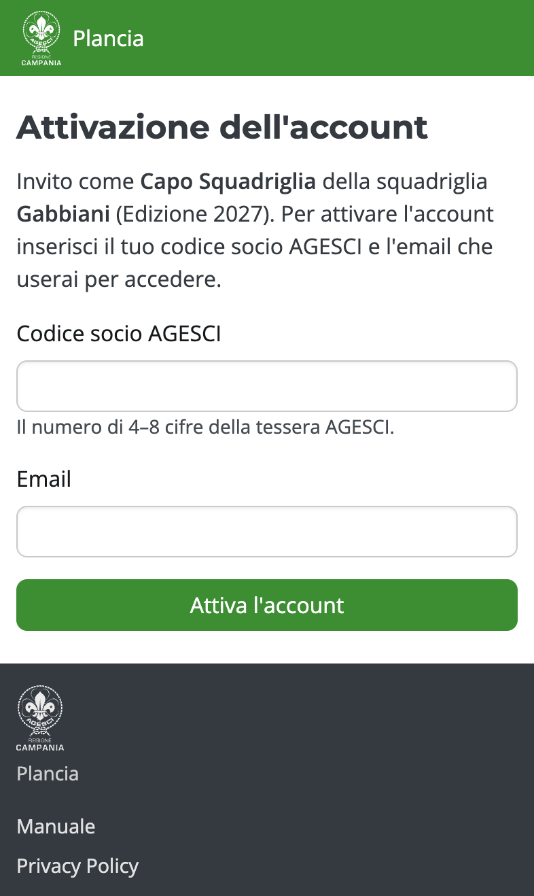{ width="300" }

Per poter rientrare in seguito con il codice socio, imposta subito una password dal menu utente
→ **Password e sicurezza** → **Cambia password** (se non ne hai mai scelta una, lascia vuoto il
campo *Password attuale*), oppure aggiungi una **passkey** per entrare con impronta o volto.

> **Codice non corretto?** Controlla di inserire il numero della tessera, non il nome utente di
> altre piattaforme AGESCI. Se il problema resta, chiedi al tuo Capo Reparto.
>
> **Link scaduto o perso?** Il tuo Capo Reparto può reinviarlo dalla pagina **Inviti** (il link
> precedente smette di funzionare).

### Installa l'app sul telefono

Conviene installare Plancia sul telefono: la ritrovi nella schermata Home con l'icona verde del
**Diario di bordo** e puoi compilare anche al campo, senza rete. Le istruzioni per iPhone e
Android sono nella [panoramica](index.md#installare-plancia-sul-telefono).

---

## Accessi successivi

Dalla pagina **Accedi a Plancia** scrivi il tuo **codice socio** (oppure l'email) nel campo
*Email o codice socio*, la password e premi **Accedi**. Con una passkey registrata basta
**Accedi con una passkey**.

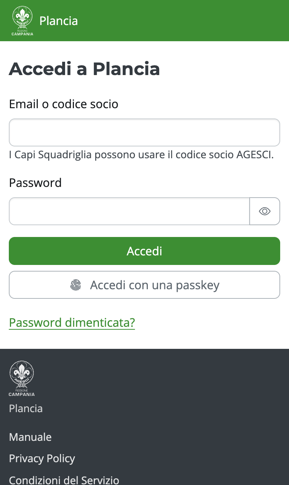{ width="300" }

---

## La home

Dopo l'accesso la home mostra l'edizione in corso dei Guidoncini Verdi (scadenze e date
dell'evento) e il diario della tua squadriglia, con il suo stato. Tocca il nome della squadriglia
per aprirlo.

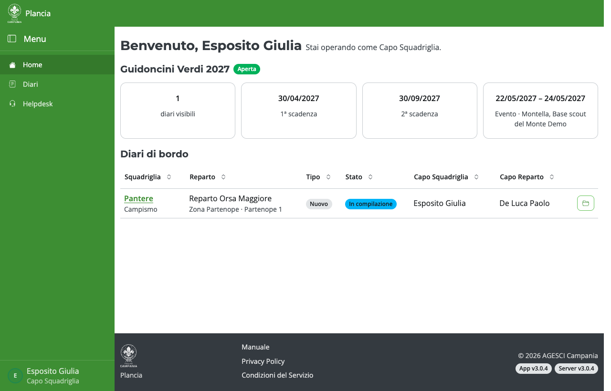

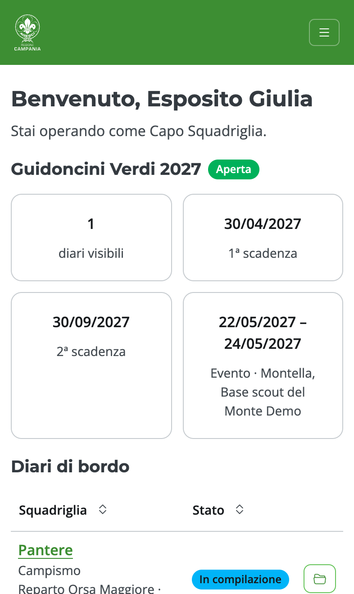{ width="300" }

---

## Il diario

La pagina del diario mostra:

- lo **stato** del diario e il tipo (*Nuovo* o *Rinnovo*);
- Capo Squadriglia, Capo Reparto e la **scadenza** (con l'eventuale dilazione concessa);
- il riquadro **Azioni**, con **Invia al Capo Reparto** quando tutti i moduli obbligatori sono
  compilati;
- **Stato della compilazione**: un riquadro per modulo, verde se compilato, giallo se manca;
  toccalo per aprire il modulo;
- sotto, il contenuto di ogni modulo con il pulsante **Compila**.

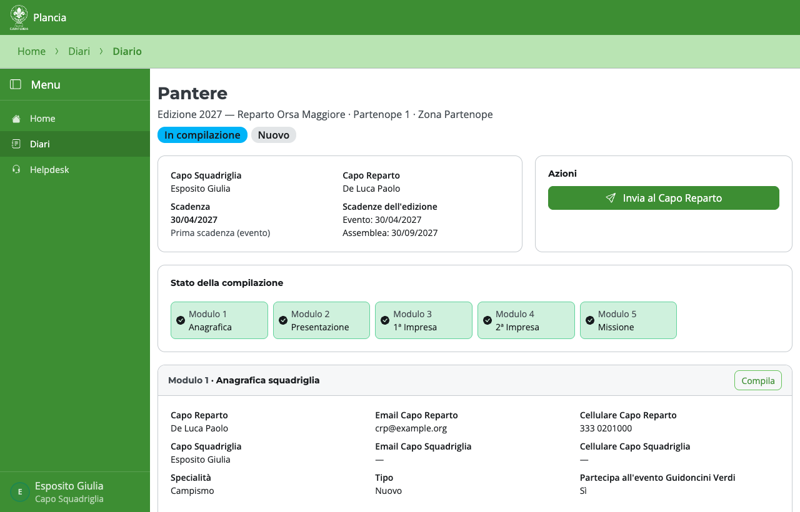

---

## Compilare i moduli

Ogni modulo ha in cima la barra dei moduli (1 Anagrafica, 2 Presentazione, 3 1ª impresa,
4 2ª impresa, 5 Missione, Foto): il segno di spunta verde indica i moduli già compilati.
Puoi passare da uno all'altro in qualunque ordine.

### Salvataggio automatico

Non c'è un pulsante *Salva* da ricordare: mentre scrivi, la barra in fondo alla pagina mostra
**Modifiche da salvare…**, poi **Salvataggio in corso…** e infine **Salvato alle …**.

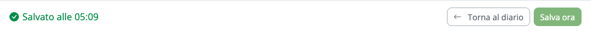

- **Salva ora** salva subito, senza aspettare.
- Se il salvataggio non riesce compare **Non salvato** con **Riprova**: le modifiche restano nella
  pagina e vengono ritentate da sole.
- **Correggi i campi evidenziati**: qualche campo non è valido (per esempio un link scritto male);
  il messaggio è sotto il campo.
- **Torna al diario** riporta alla pagina del diario.

Se lo stesso modulo viene salvato da un'altra persona (o da un tuo altro dispositivo) mentre lo
stai modificando, compare l'avviso *"Questo modulo è stato modificato altrove"*: scegli
**Ricarica la versione salvata** (perdi le modifiche fatte qui) oppure **Sovrascrivi con le mie
modifiche**.

### Modulo 1 — Anagrafica

- **Nome squadriglia**: puoi correggerlo; la modifica rinomina anche le cartelle su Google Drive.
- **Tipo partecipazione**: **Nuovo** se la squadriglia partecipa per la prima volta, **Rinnovo**
  se ha già conquistato la specialità. Per il Rinnovo la 2ª impresa e la missione sono
  facoltative; per il Nuovo sono obbligatorie per poter inviare.
- **Capo Reparto** e **Capo Squadriglia**: cognome, nome e cellulare. Le email le modifica solo lo
  staff (etichetta *solo staff*).
- **Specialità di squadriglia** (le 12 specialità ufficiali) e **Partecipa all'evento Guidoncini
  Verdi**.
- **Note da import (precompilazione)**: descrizioni delle imprese e tecniche arrivate
  dall'iscrizione, in sola lettura.

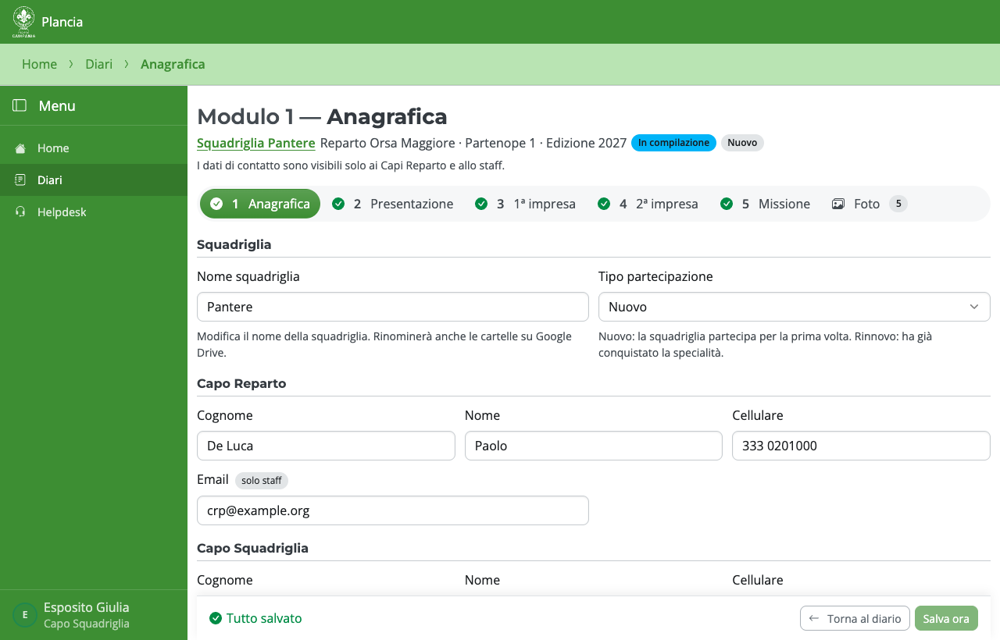

### Modulo 2 — Presentazione della squadriglia

Scrivi **Cosa sappiamo fare** e compila i **Membri della squadriglia**: per ognuno *Nome e
cognome*, *Ruolo in squadriglia* (Capo Squadriglia, Vice Capo Squadriglia, Squadrigliere, Tutti
gli altri) e *Tappa sentiero* (Scoperta, Competenza, Responsabilità). Con **Aggiungi membro**
aggiungi una riga, con l'icona del cestino la togli.

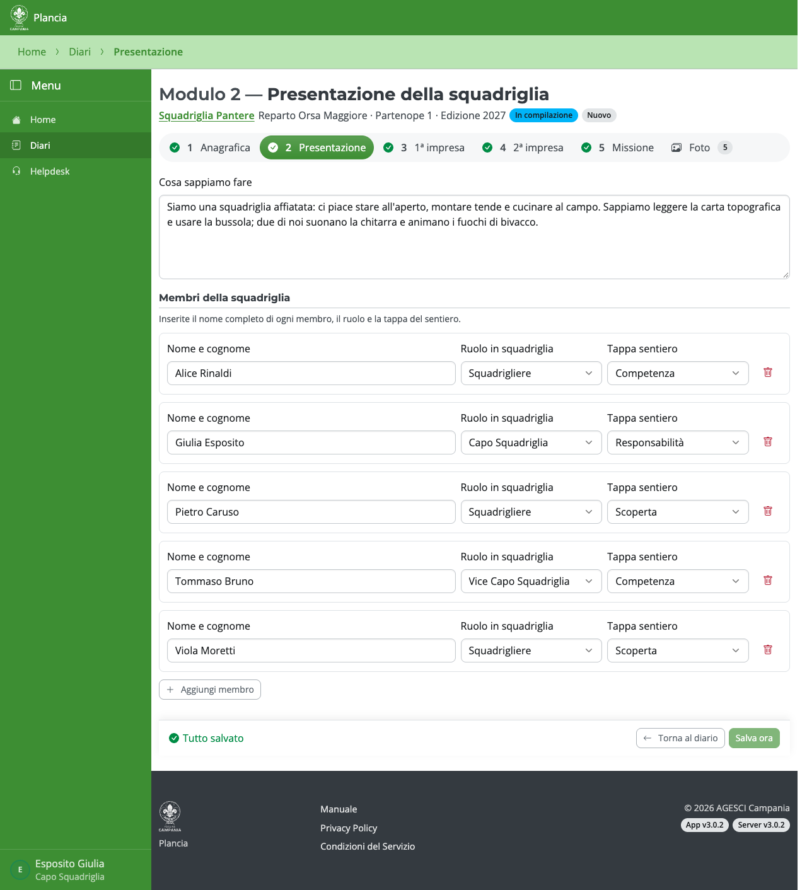

### Moduli 3 e 4 — 1ª e 2ª impresa

- **Titolo**, **Data inizio**, **Data fine**.
- **Perché**: perché avete scelto questa impresa, cosa vi ha spinto a farla.
- **Come**: come avete progettato il lavoro, quali competenze avete acquisito, come vi siete
  divisi i posti d'azione.
- **Cosa**: cosa avete fatto, dove, tutto ciò che serve a capire il vostro lavoro.
- **Link esterno (video/materiale)**: un link a YouTube, OneDrive, Google Drive… se avete un video
  o altro materiale.
- **Posti d'azione**: per ognuno **Chi** l'ha svolto e **Cosa** ha fatto (**Aggiungi posto
  d'azione**).
- **Specialità individuali** e **Brevetti di competenza**: *Chi*, la specialità o il brevetto
  dall'elenco ufficiale e lo *Stato* (In cammino, Conquistata, Non conquistata).
- **Foto** dell'impresa (vedi sotto).

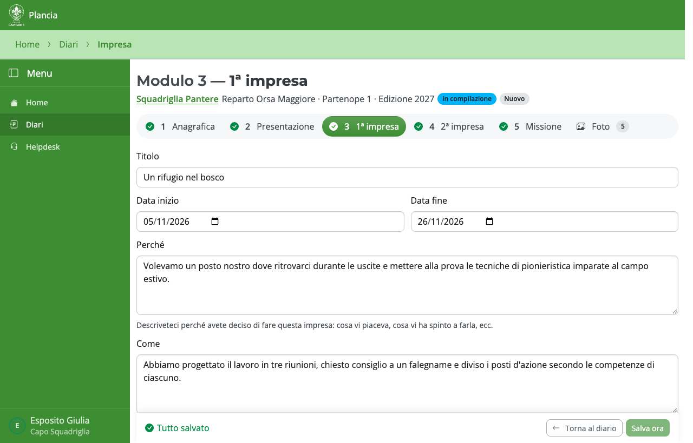

La 2ª impresa ha la stessa struttura; per il Rinnovo è segnata *(facoltativo)*.

### Modulo 5 — Missione

**Titolo**, **Data** e **Descrizione e svolgimento**: gli obiettivi che vi sono stati dati, le
tecniche usate, le competenze richieste, come vi siete divisi i posti d'azione, gli eventuali
problemi. In fondo le **Foto** della missione.

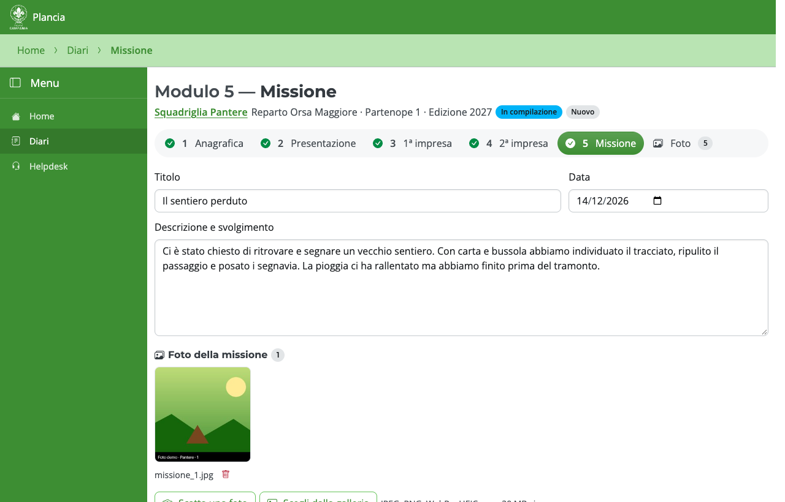

---

## Le foto

Le foto si aggiungono in fondo ai moduli 3, 4 e 5, oppure dalla voce **Foto** della barra dei
moduli, che le raccoglie tutte.

- **Scatta una foto** apre la fotocamera del telefono; **Scegli dalla galleria** permette di
  sceglierne più di una. Formati JPEG, PNG, WebP o HEIC; le immagini grandi vengono ridotte
  automaticamente.
- Durante l'invio ogni foto mostra una barra di avanzamento; in caso di errore **Riprova** o
  **Rimuovi**.
- Tocca una miniatura per vederla grande: da lì puoi **Scaricarla** o **Eliminarla**. Le foto si
  possono eliminare finché il Capo Reparto non invia il diario.

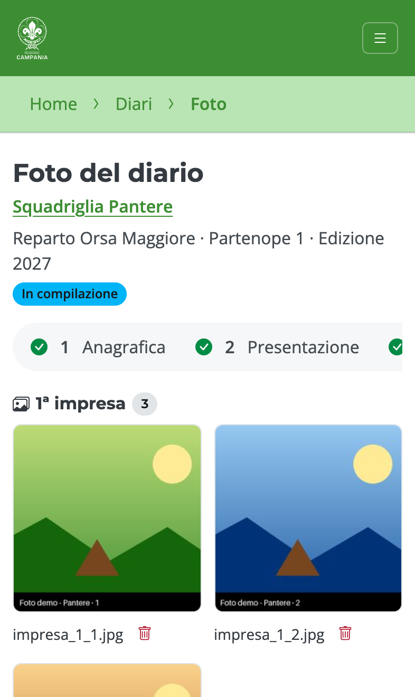{ width="300" }

---

## Senza connessione

Al campo puoi continuare a compilare anche senza rete, purché tu abbia aperto il diario e i
moduli almeno una volta con la connessione:

1. nell'intestazione compare **Offline**;
2. le modifiche e le foto restano sul telefono: il segnale giallo **N da inviare** ne indica il
   numero e le foto in attesa mostrano *"Sul dispositivo: verrà inviata online"*;
3. quando torna la connessione vengono inviate da sole (anche solo riaprendo l'app); puoi toccare
   **N da inviare** per inviarle subito.

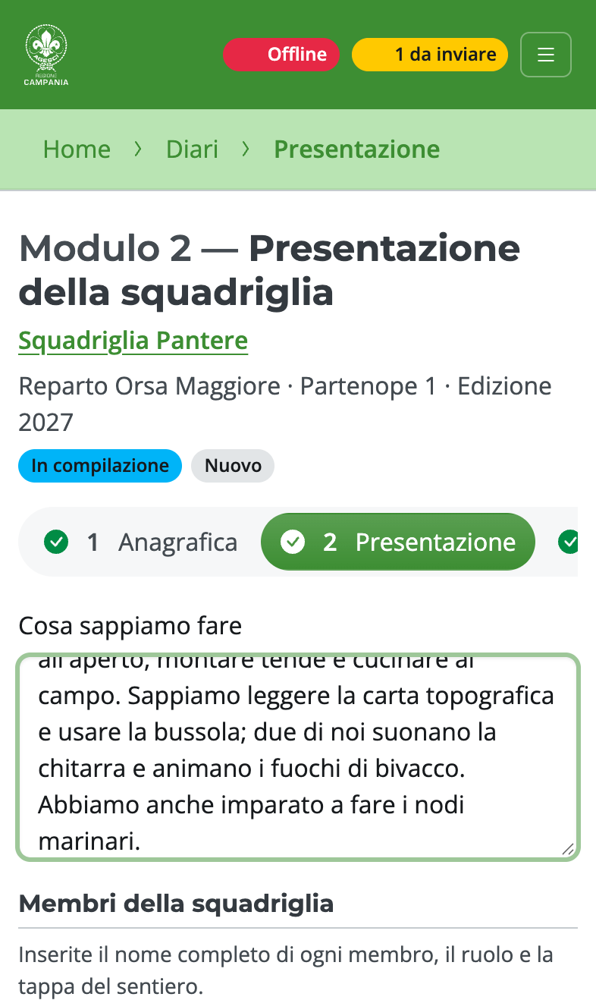{ width="300" }

> **Consiglio**: prima di uscire da Plancia (o di disinstallarla) aspetta che il segnale **da
> inviare** sparisca, altrimenti le modifiche rimaste sul telefono vanno perse.

---

## Inviare la propria parte al Capo Reparto

Quando tutti i moduli obbligatori sono compilati, nella pagina del diario compare **Invia al
Capo Reparto**. Dopo la conferma il diario passa in *Relazione finale*: il Capo Reparto compila
il suo modulo e invia il diario allo staff. Da quel momento i tuoi moduli non sono più
modificabili, salvo riapertura da parte dello staff.

La valutazione e la Relazione finale del Capo Reparto non sono visibili al Capo Squadriglia.

---

## Serve aiuto?

Dalla voce **Helpdesk** del menu apri una richiesta alla Segreteria e agli Incaricati EG con
**Nuovo ticket**: scrivi *Oggetto*, scegli la *Categoria* (Problema tecnico, Difficoltà di
compilazione, Problema di accesso, Richiesta dilazione, Altro), la *Descrizione* e, se serve, il
*Diario collegato*, poi **Apri ticket**. Le risposte arrivano nella pagina del ticket, dove puoi
rispondere a tua volta.

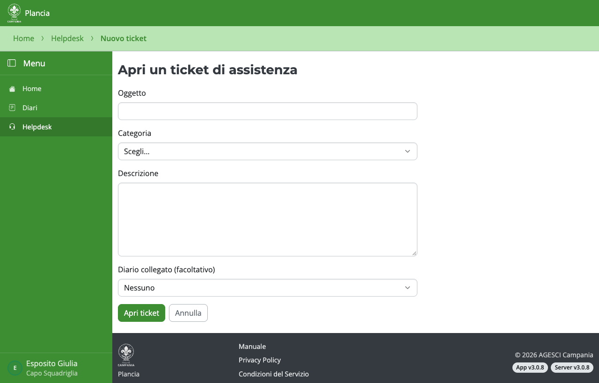
