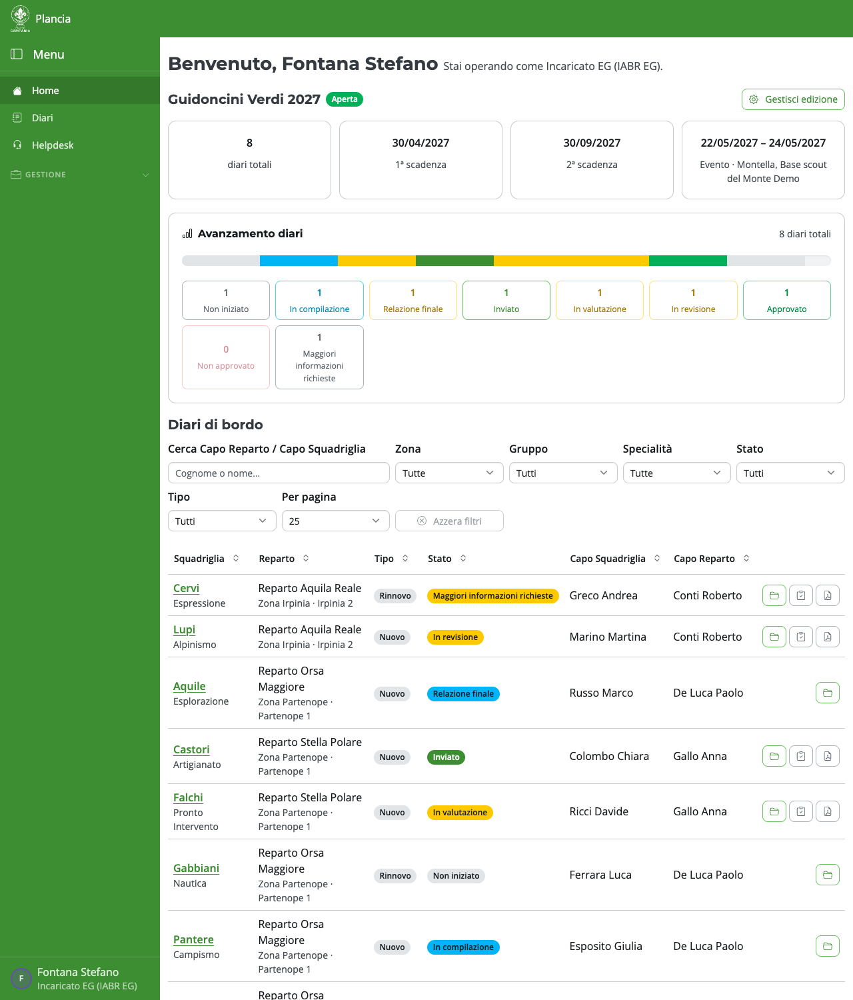
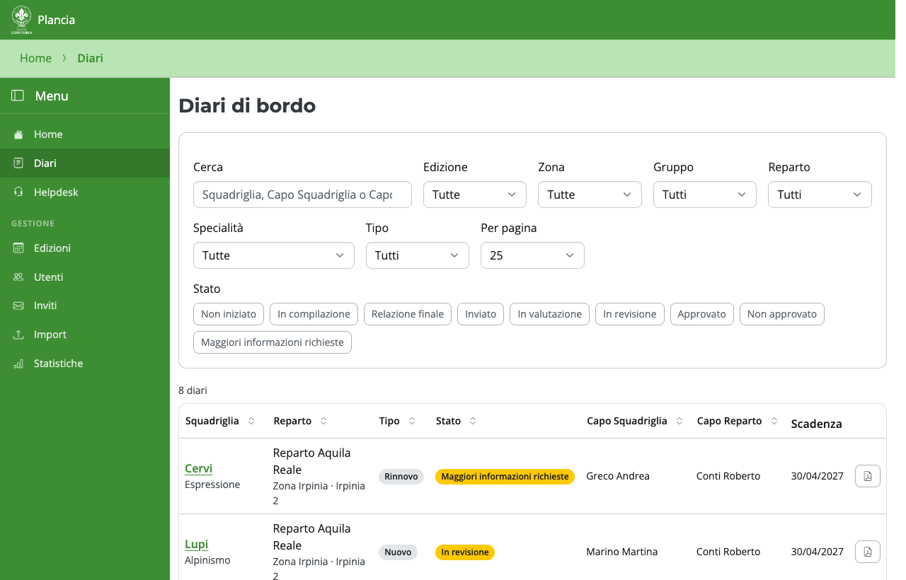
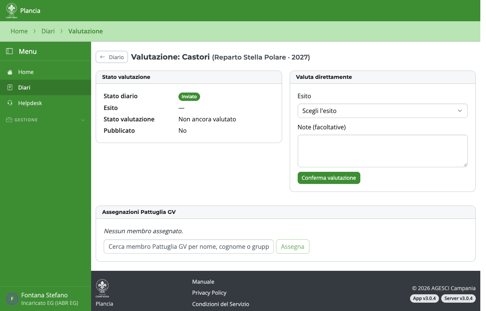
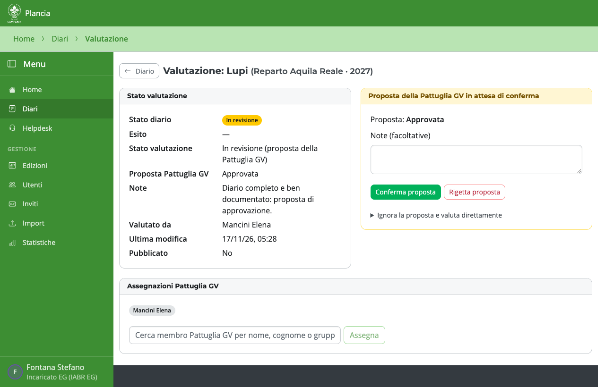
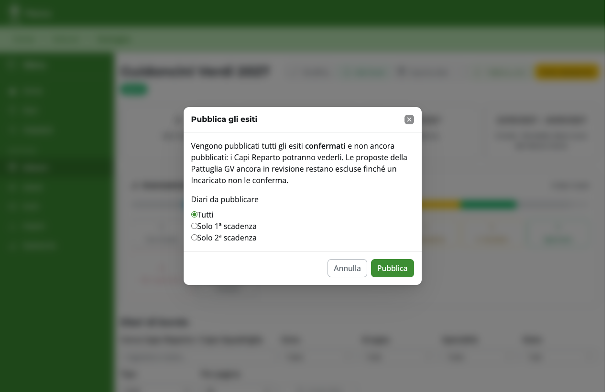
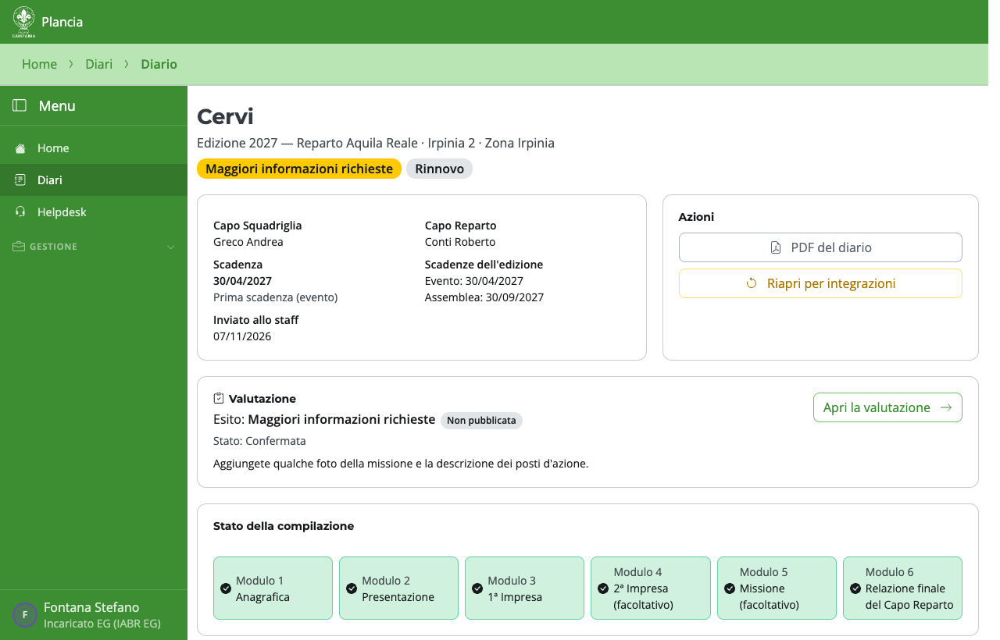
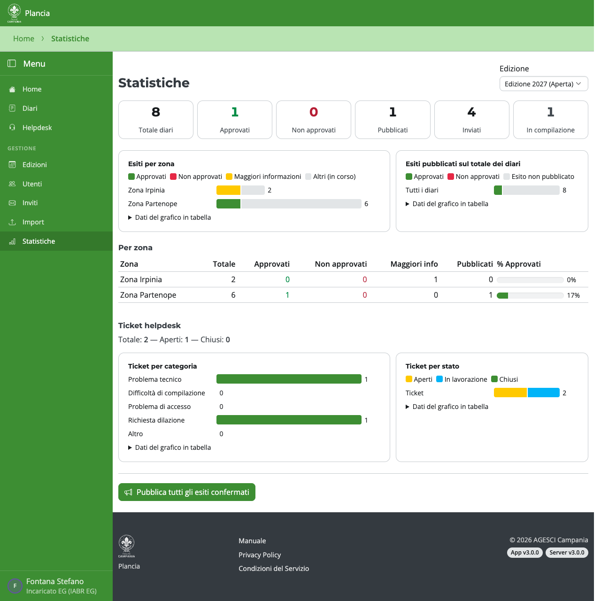

# Guida — Incaricato EG

L'Incaricato EG guida la valutazione: valuta direttamente o coinvolge la Pattuglia GV, conferma o
rigetta le proposte, può modificare qualunque esito fino alla pubblicazione e pubblica gli esiti
ufficiali. Ha anche accesso alla gestione (edizioni, utenti, inviti, import: vedi la
[guida della Segreteria](segreteria.md), tranne **Impersona utente**, riservato a Segreteria e
Admin) e alle **Statistiche**.

> L'Incaricato EG deve usare la **verifica in due passaggi**: al primo accesso Plancia porta alla
> pagina *Password e sicurezza* per configurarla (salvo accesso con SSO AGESCI Campania, o se
> l'Admin l'ha resa facoltativa).

---

## Flussi di valutazione

Per ogni diario puoi scegliere il flusso più adatto, senza configurazioni preventive:

**Flusso diretto**

```
Diario inviato → Valutazione dell'Incaricato → Pubblicazione
```

**Flusso con la Pattuglia GV**

```
Diario inviato → Assegnazione (il diario passa In valutazione)
              → Proposta della Pattuglia GV (In revisione)
              → Conferma dell'Incaricato → Pubblicazione
```

---

## Home e lista dei diari

La home mostra l'edizione attiva con il pulsante **Gestisci edizione**, i contatori per stato
(cliccandoli filtri la tabella) e la tabella di tutti i diari. Accanto a ogni diario inviato,
l'icona **Valutazione** (cartellina con la spunta) apre direttamente la pagina di valutazione.



La voce **Diari** apre l'elenco completo di tutte le squadriglie, con ricerca, filtri combinabili
(edizione, zona, gruppo, reparto, specialità, tipo, stati) e ordinamento.



---

## La pagina di valutazione

Si apre dall'icona **Valutazione** nella tabella dei diari (home o pagina dell'edizione) oppure
da **Apri la valutazione** nel diario, che compare appena il diario è inviato. A sinistra c'è lo
**Stato valutazione** (stato del diario, esito, proposta della Pattuglia GV, note, chi ha valutato
e confermato, pubblicazione); a destra le azioni possibili; in basso le **Assegnazioni
Pattuglia GV**.

### Valutare direttamente

Nel riquadro **Valuta direttamente** scegli l'**Esito** — *Approvata*, *Non approvata* o
*Maggiori informazioni richieste* — aggiungi le note e premi **Conferma valutazione**. Funziona
anche con il diario ancora *Inviato*: la valutazione si avvia da sola.



### Assegnare il diario alla Pattuglia GV

Nel riquadro **Assegnazioni Pattuglia GV** cerca il membro per nome, cognome o gruppo, sceglilo e
premi **Assegna**. Si possono assegnare più membri; ognuno vedrà il diario tra i propri *Diari
assegnati*. Un diario ancora *Inviato* passa **In valutazione** alla prima assegnazione, così la
Pattuglia può proporre l'esito.

### Confermare o rigettare una proposta

Quando un membro della Pattuglia propone *Approvata* o *Non approvata*, il diario va **In
revisione** e compare il riquadro giallo **Proposta della Pattuglia GV in attesa di conferma**:

- **Conferma proposta** (con eventuali note) rende definitivo l'esito proposto;
- **Rigetta proposta** riporta il diario *In valutazione*;
- **Ignora la proposta e valuta direttamente** apre il modulo di valutazione diretta, per
  decidere un esito diverso.



### Modificare un esito

Finché non è pubblicato, l'esito si può cambiare dal riquadro **Modifica esito** → **Aggiorna
valutazione**.

---

## Pubblicare gli esiti

Gli esiti diventano visibili ai Capi Reparto solo dopo la pubblicazione.

- **Singolo diario**: nella pagina di valutazione, **Pubblica esito**.
- **Tutti insieme**: nella pagina dell'edizione (**Gestisci edizione**) premi **Pubblica esiti** e
  scegli *Tutti*, *Solo 1ª scadenza* o *Solo 2ª scadenza*, poi **Pubblica**. Vengono pubblicati
  gli esiti **confermati** e non ancora pubblicati; le proposte ancora in revisione restano
  escluse. Lo stesso comando è nelle Statistiche: **Pubblica tutti gli esiti confermati**.



> Dopo la pubblicazione l'esito non si può più modificare.

---

## Riapertura per integrazioni

Un diario *Non approvato* o con *Maggiori informazioni richieste* si può riaprire con **Riapri per
integrazioni** (riquadro Azioni del diario), purché sia stato valutato sulla **1ª scadenza** e la
2ª non sia ancora passata. Il diario torna *In compilazione* e il Capo Squadriglia può modificarlo
di nuovo.



---

## Dilazioni

Dal diario (**Concedi dilazione**) o dalla pagina dell'edizione (riquadro **Dilazioni**) puoi
concedere a una squadriglia una **Nuova scadenza** con la **Motivazione**, finché il diario non è
stato inviato allo staff. Il diario mostra il badge *Dilazione concessa*.

---

## Statistiche

La voce **Statistiche** (sezione *Gestione*) mostra, per l'edizione scelta, gli indicatori
principali (diari totali, approvati, non approvati, pubblicati, inviati, in compilazione), gli
**Esiti per zona**, gli esiti pubblicati sul totale, la tabella **Per zona** e i **Ticket
helpdesk** collegati ai diari, per categoria e per stato. Ogni grafico ha i dati anche in tabella
(*Dati del grafico in tabella*).


