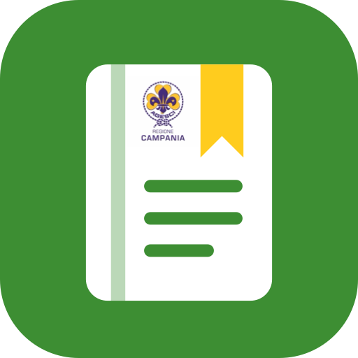
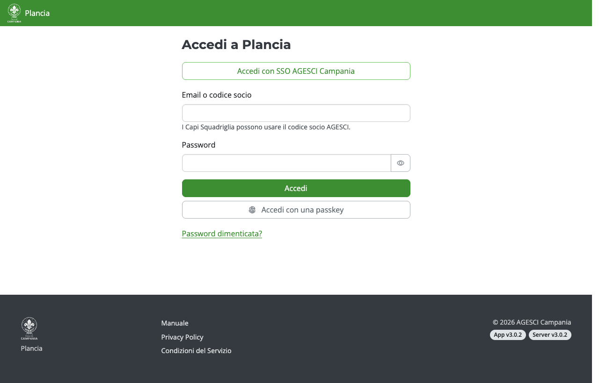
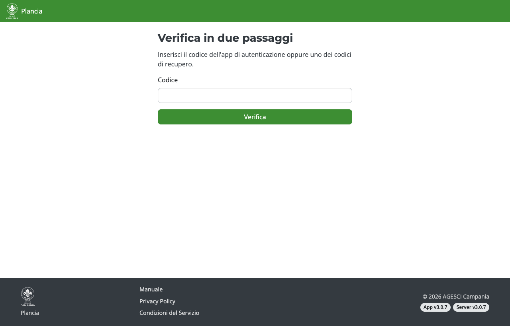
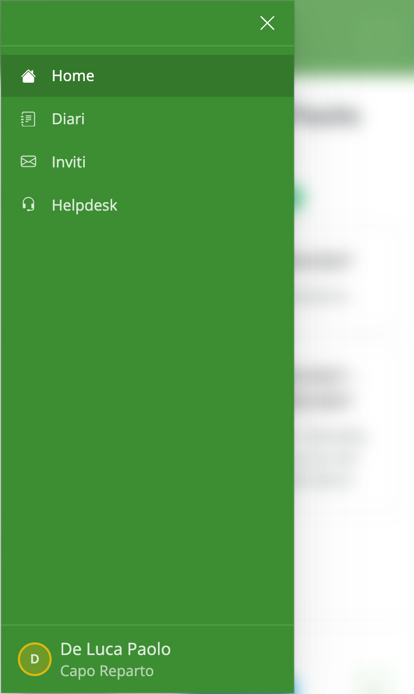
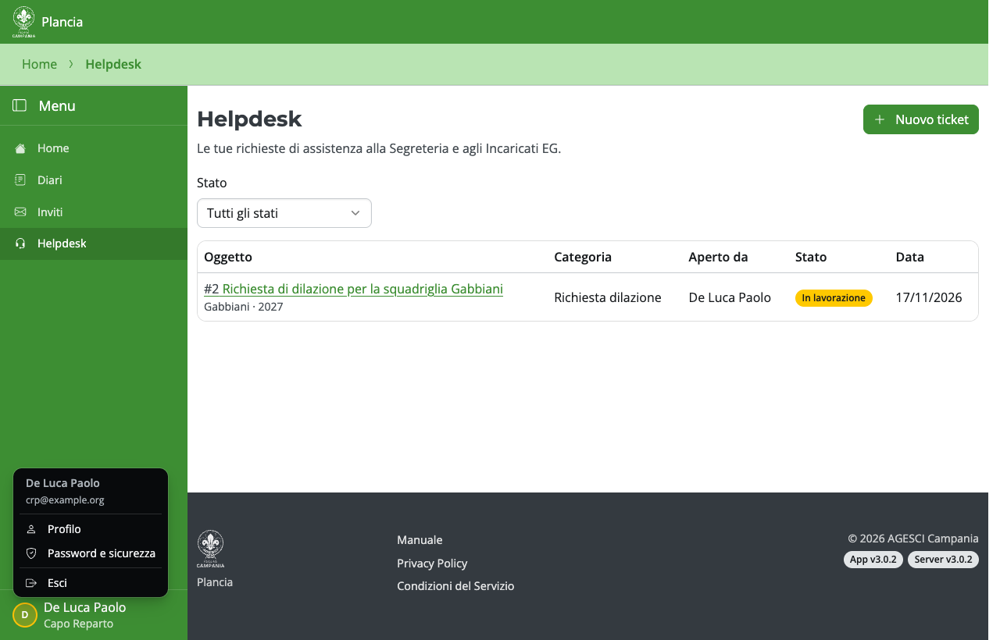
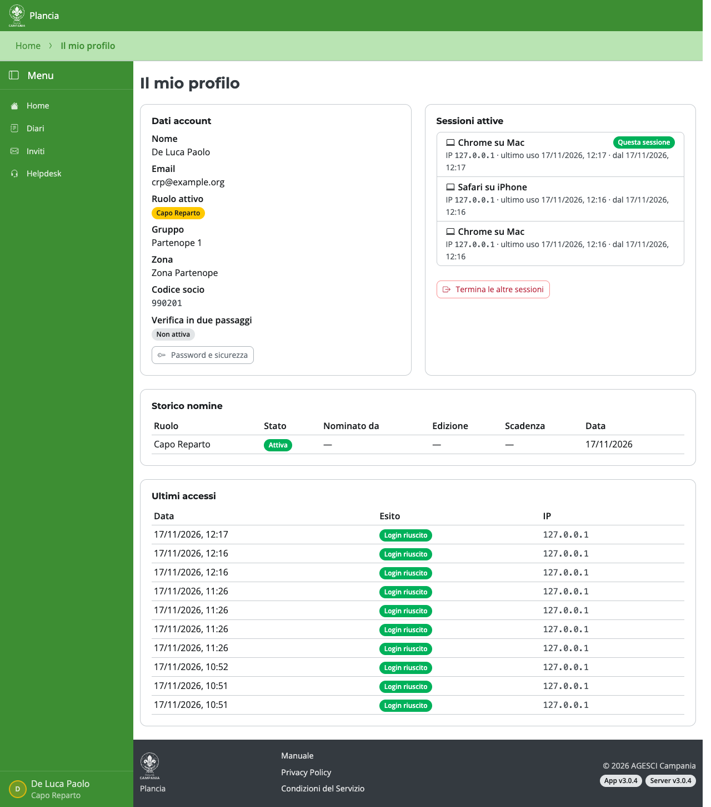
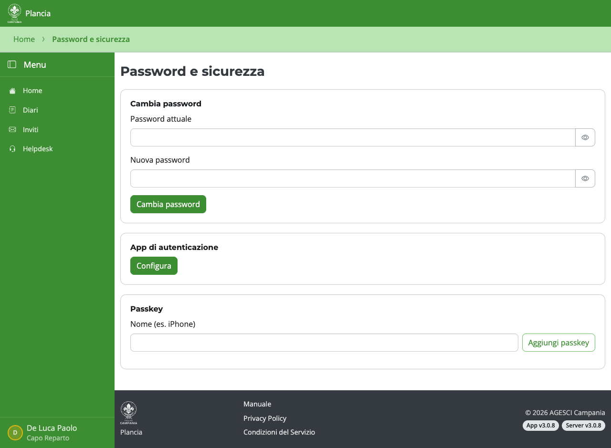
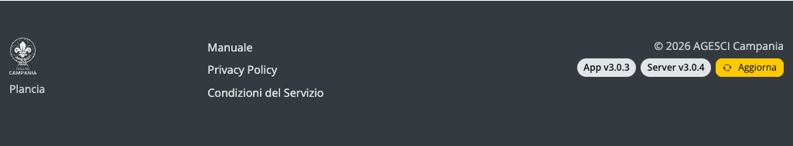
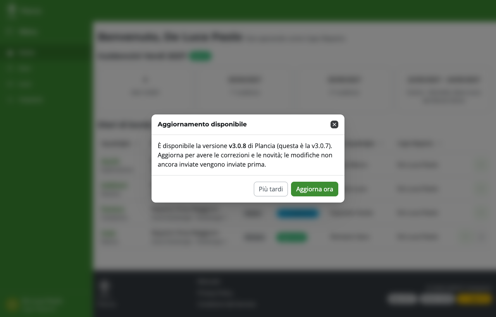
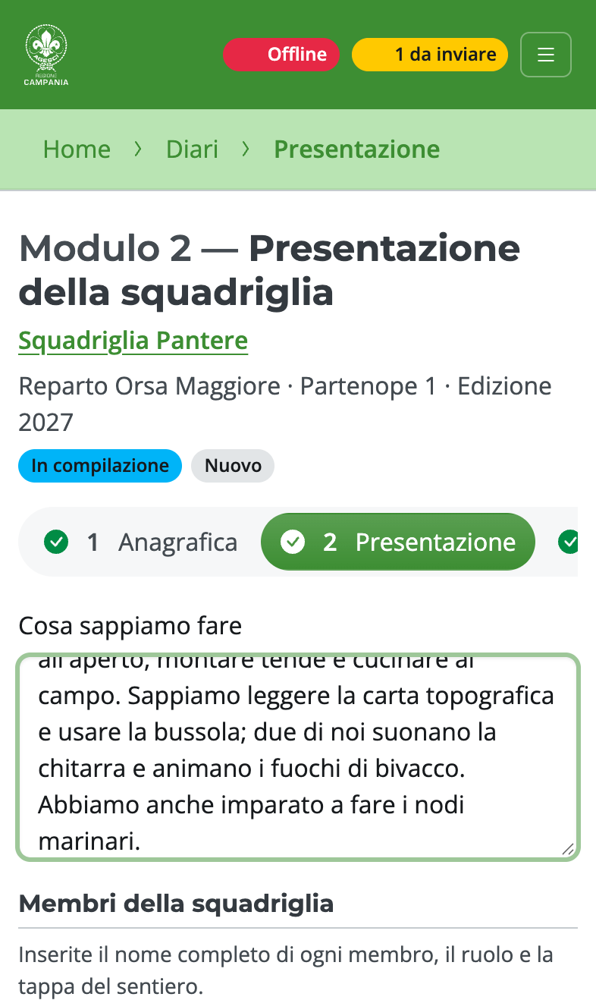

# Manuale d'uso — Plancia

**Piattaforma Guidoncini Verdi · AGESCI Campania**

Plancia è l'app per la gestione del concorso Guidoncini Verdi della Branca E/G. Le squadriglie
compilano il Diario di Bordo, i Capi Reparto lo integrano con la Relazione finale, la Pattuglia
Guidoncini Verdi e gli Incaricati EG lo valutano, la Segreteria e gli Amministratori gestiscono
l'edizione e la piattaforma.

Dalla versione 3 Plancia è un'unica app che funziona allo stesso modo nel browser del computer
e sul telefono, dove si installa come un'app vera e propria e si usa anche senza connessione.

---

## Guida per ruolo

| Ruolo | Funzione principale |
|---|---|
| [Capo Squadriglia](csq.md) | Compila i moduli 1–5 del Diario di Bordo, anche dal telefono e offline |
| [Capo Reparto](crp.md) | Segue i diari del reparto, compila la Relazione finale e invia il diario |
| [Pattuglia Guidoncini Verdi](pgv.md) | Propone la valutazione dei diari che le sono assegnati |
| [Incaricato EG](incaricato.md) | Valuta, conferma le proposte e pubblica gli esiti |
| [Segreteria](segreteria.md) | Gestisce edizioni, utenti, inviti, import e helpdesk |
| [Amministratore](admin.md) | Configura la piattaforma, l'accesso, Drive, la posta e aggiorna il server |

Chi ha più ruoli (per esempio Incaricato EG e Pattuglia GV) sceglie con quale operare dal menu
utente, alla voce **Opera come**.

---

## Struttura del Diario di Bordo

Il Diario è composto da sei moduli:

| Modulo | Titolo | Chi compila |
|---|---|---|
| 1 | Anagrafica | Capo Squadriglia (le email solo lo staff) |
| 2 | Presentazione della squadriglia | Capo Squadriglia |
| 3 | 1ª impresa | Capo Squadriglia |
| 4 | 2ª impresa *(facoltativa per il Rinnovo)* | Capo Squadriglia |
| 5 | Missione *(facoltativa per il Rinnovo)* | Capo Squadriglia |
| 6 | Relazione finale del Capo Reparto | Capo Reparto *(mai visibile al Capo Squadriglia)* |

Alle imprese e alla missione si allegano le **foto**.

### Gli stati del diario

| Stato | Cosa significa |
|---|---|
| **Non iniziato** | Il diario esiste ma nessuno ha ancora salvato un modulo |
| **In compilazione** | Il Capo Squadriglia sta compilando i moduli 1–5 |
| **Relazione finale** | Il Capo Squadriglia ha inviato la sua parte: tocca al Capo Reparto |
| **Inviato** | Il Capo Reparto ha inviato il diario allo staff: non è più modificabile |
| **In valutazione** | La valutazione è iniziata (eventualmente con la Pattuglia GV) |
| **In revisione** | La Pattuglia GV ha proposto un esito che un Incaricato EG deve confermare |
| **Approvato** / **Non approvato** | Esito deciso dagli Incaricati EG |
| **Maggiori informazioni richieste** | Lo staff chiede integrazioni: il diario può essere riaperto |

### Flusso di compilazione

1. Il **Capo Squadriglia** compila i moduli 1–5 (il diario passa da *Non iniziato* a
   *In compilazione* al primo salvataggio) e preme **Invia al Capo Reparto**.
2. Il diario passa in **Relazione finale**: il **Capo Reparto** compila il modulo 6 e preme
   **Invia il diario allo staff**.
3. Il diario è **Inviato**: gli Incaricati EG lo valutano, direttamente o con la Pattuglia GV,
   e pubblicano l'esito. Prima della pubblicazione l'esito non è visibile a nessuno fuori dallo
   staff; il Capo Squadriglia non vede mai né la Relazione finale né la valutazione.

---

## Installare Plancia sul telefono

Plancia si installa direttamente dal browser, senza passare dagli store. Una volta installata
compare nella schermata Home con l'icona verde del **Diario di bordo** e il nome *Plancia*, si
apre a tutto schermo come un'app e funziona anche senza connessione.

{ width="96" }

**iPhone e iPad (Safari, iOS 18 o successivo)**

1. Apri l'indirizzo di Plancia con **Safari**.
2. Tocca il pulsante **Condividi** (il quadrato con la freccia in su).
3. Scorri e tocca **Aggiungi alla schermata Home**, poi **Aggiungi**.

**Android (Chrome)**

1. Apri l'indirizzo di Plancia con **Chrome**.
2. Tocca il menu con i tre puntini in alto a destra e scegli **Installa app** (o **Aggiungi a schermata
   Home**), poi conferma.

Sul computer puoi installarla allo stesso modo da Chrome o Edge (icona di installazione nella
barra dell'indirizzo), oppure usarla semplicemente nel browser.

---

## Accedere

L'indirizzo della piattaforma viene comunicato dalla Segreteria regionale. La prima volta si
attiva l'account dal link dell'invito ricevuto (vedi la guida del proprio ruolo); dopo si entra
dalla pagina **Accedi a Plancia**.

Modi di accesso:

- **Email o codice socio** e **Password**, poi **Accedi**. I Capi Squadriglia possono scrivere il
  proprio **codice socio AGESCI** (il numero della tessera) al posto dell'email. Il pulsante con
  l'occhio accanto alla password la mostra mentre la scrivi (di nuovo per nasconderla); c'è in
  tutti i campi password di Plancia.
- **Accedi con SSO AGESCI Campania**: lo stesso account usato per tutte le piattaforme regionali
  (`https://auth.agescicampania.net`). Al primo accesso Plancia riconosce l'account
  dall'indirizzo email; se non esiste ancora lo crea senza ruoli (li assegnano la Segreteria o
  gli Incaricati EG).
- **Accedi con Google / Microsoft / Apple**, se configurati dall'Admin: l'email del provider deve
  corrispondere a un account già esistente.
- **Accedi con una passkey** (Face ID, Touch ID, Windows Hello, impronta), se ne hai registrata
  una in *Password e sicurezza*.

I pulsanti dei provider compaiono solo se sono configurati sul server.

**Password dimenticata?** Dalla pagina di accesso apri **Password dimenticata?**, scrivi l'email
e premi **Invia il link**: riceverai un'email con il link per scegliere una nuova password.

### Verifica in due passaggi

Admin, Segreteria e Incaricati EG devono usare la **verifica in due passaggi** (MFA). Dopo email
e password Plancia chiede il **Codice** dell'app di autenticazione (Google Authenticator, Aegis,
Authy…) oppure uno dei codici di recupero; in alternativa **Usa una passkey**.

- Entrando con **SSO AGESCI Campania** la verifica la chiede l'SSO, una volta sola per tutte le
  piattaforme: Plancia non la richiede di nuovo.
- Se il tuo ruolo richiede la verifica e non l'hai ancora configurata, Plancia ti porta subito
  alla pagina **Password e sicurezza** finché non attivi l'app di autenticazione o una passkey.

I ruoli **Admin** e **Segreteria** assegnati nell'SSO regionale valgono anche in Plancia e sono
aggiornati a ogni accesso con SSO: se vengono tolti lì, spariscono anche qui.

---

## Come è fatta l'app

- **Menu laterale**: le voci dipendono dal ruolo (Home, Diari, Helpdesk; per lo staff anche le
  sezioni *Gestione* e *Sistema*). Le sezioni sono chiuse: un clic sul titolo apre le voci e
  chiude l'altra sezione; quella della pagina in cui ti trovi resta aperta. Sul computer il pulsante **Menu** in cima lo comprime a sole
  icone; sul telefono si apre con il pulsante con le tre linee in alto a destra.
- **Percorso** (la barra verde chiaro sotto l'intestazione): mostra dove ti trovi e permette di
  tornare indietro con un tocco.
- **Menu utente**, in fondo al menu laterale (il tuo nome e il ruolo): **Opera come** per chi ha
  più ruoli, **Profilo**, **Password e sicurezza**, **Esci**.

{ width="300" }

### Profilo

**Il mio profilo** mostra i dati dell'account (ruolo attivo, gruppo, zona, codice socio, stato
della verifica in due passaggi), le **Sessioni attive** con il pulsante **Termina le altre
sessioni**, gli **Account collegati** (SSO o provider social, con **Scollega**), lo **Storico
nomine** e gli **Ultimi accessi**. Chi può farlo trova anche **Modifica email**. Chi non è
collegato a un socio AGESCI (per esempio lo staff entrato con l'SSO) trova **Modifica nome**, con
Nome e Cognome; per gli altri il nome viene dall'anagrafica.

Chi entra con **SSO AGESCI Campania** vede anche la propria **immagine del profilo** (nel profilo e
in fondo al menu laterale): arriva da Sestante e si aggiorna a ogni accesso con l'SSO. Per
cambiarla o toglierla si usa il proprio profilo su Sestante (link nella pagina).

### Password e sicurezza

Dal menu utente → **Password e sicurezza**:

- **Cambia password**: *Password attuale* e *Nuova password*.
- **App di autenticazione**: **Configura**, inquadra il codice QR con l'app (o inserisci a mano il
  codice mostrato), scrivi il codice a 6 cifre e premi **Attiva**. Salva subito i **Codici di
  recupero** (pulsanti **Mostra** e **Rigenera**): servono se perdi il telefono.
- **Passkey**: scrivi un nome (es. *iPhone*) e premi **Aggiungi passkey**; il dispositivo chiede
  impronta, volto o PIN. Le passkey registrate si possono eliminare con **Elimina**.

Per le operazioni delicate (attivare o disattivare la verifica, aggiornare il server…) Plancia
può chiedere di **confermare la tua identità** con la password o un codice di verifica.

---

## Aggiornamenti dell'app

In fondo a ogni pagina il piè di pagina mostra due etichette: **App** (la versione installata sul
tuo dispositivo) e **Server** (la versione installata sul server).

Quando esce una nuova versione compare la finestra **Aggiornamento disponibile**:

- **Aggiorna ora** invia prima le eventuali modifiche fatte offline e poi ricarica l'app alla
  nuova versione;
- **Più tardi** rimanda: la finestra si ripresenta al prossimo avvio, e intanto nel piè di
  pagina resta il pulsante **Aggiorna**.

Senza connessione la finestra non compare (non si potrebbe scaricare la nuova versione). Se
restano modifiche non ancora inviate, l'aggiornamento aspetta che la connessione sia stabile.

---

## Uso senza connessione

Plancia funziona anche offline, per esempio al campo:

- nell'intestazione compare il segnale rosso **Offline**;
- i moduli che hai già aperto almeno una volta con la connessione restano consultabili e
  modificabili (*"Sei offline: vedi i dati salvati sul dispositivo"*);
- le modifiche ai moduli e le foto restano **sul dispositivo** e il segnale giallo
  **N da inviare** ne indica il numero;
- al ritorno della connessione (o quando riapri l'app, e comunque ogni minuto) vengono inviate da
  sole; con la connessione attiva puoi anche toccare **N da inviare** per inviarle subito.

{ width="300" }

Se nel frattempo qualcun altro ha modificato lo stesso modulo, nella pagina del modulo compare
l'avviso *"Modifiche fatte offline … non salvate"* con **Recupera le mie modifiche** (le riporta
nel modulo, da salvare o correggere) e **Scartale**.

> **Prima di uscire.** **Esci** cancella dal dispositivo i dati personali. Se ci sono modifiche
> non ancora inviate Plancia chiede conferma (*Esci e cancella*): meglio aspettare di essere
> online. Se invece la sessione scade mentre sei offline, le modifiche in coda restano: rientra e
> partono da sole.

La pagina di accesso e il primo caricamento dei dati richiedono la connessione.
