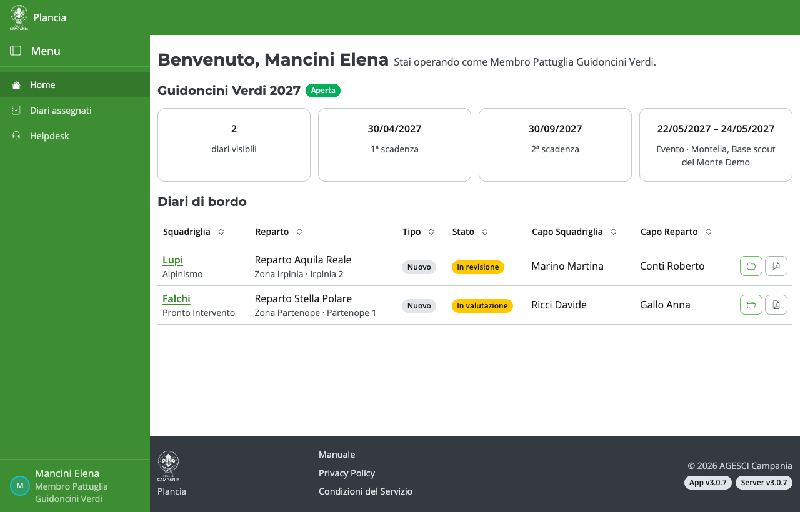
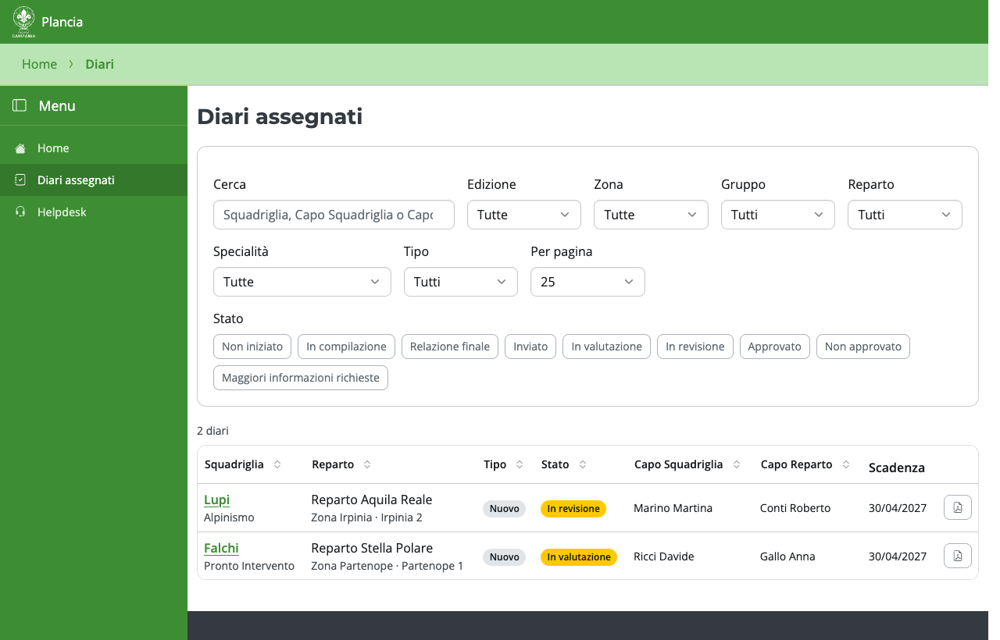
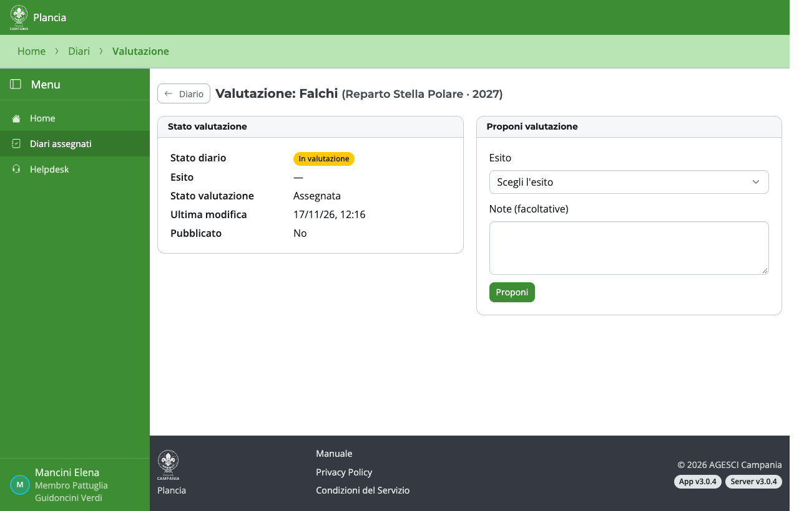

# Guida — Pattuglia Guidoncini Verdi

I membri della Pattuglia GV valutano i diari che un Incaricato EG assegna loro: leggono tutti i
moduli, compresa la Relazione finale del Capo Reparto, e **propongono** un esito che un Incaricato
EG conferma prima della pubblicazione.

---

## Home

La home mostra l'edizione in corso con i diari che ti sono stati assegnati e il loro stato.

---

## Diari assegnati

La voce **Diari assegnati** del menu elenca solo i diari che ti sono stati assegnati, con gli
stessi filtri e la ricerca della lista diari. Apri un diario per leggerne i moduli 1–6 e le foto;
dal riquadro **Azioni** puoi aprire il **PDF del diario**.

---

## Proporre la valutazione

Dal diario apri la pagina **Valutazione** con il pulsante **Apri la valutazione** del riquadro
*Valutazione* (compare nei diari che ti sono stati assegnati). A sinistra trovi lo
**Stato valutazione** (stato del diario, esito, stato della valutazione, note, ultima modifica);
a destra il riquadro **Proponi valutazione**:

1. scegli l'**Esito**: *Approvata* o *Non approvata*;
2. aggiungi le **Note (facoltative)** per motivare la proposta;
3. premi **Proponi**.

Il diario passa in stato **In revisione** e la proposta attende la conferma di un Incaricato EG.
Finché non viene confermata puoi ancora cambiarla dallo stesso riquadro (*"La tua proposta … è in
attesa di conferma da parte di un Incaricato EG. Puoi ancora cambiarla."*).

---

## Da ricordare

- Puoi **proporre** un esito, non **pubblicarlo**: la pubblicazione è riservata agli Incaricati EG.
- *Maggiori informazioni richieste* non si propone: se il diario va integrato, scrivilo nelle note
  o segnalalo all'Incaricato EG, che può decidere direttamente.
- Valuti solo i diari assegnati a te e non puoi assegnarli ad altri membri della Pattuglia.
- L'Incaricato EG può confermare la tua proposta, rigettarla (il diario torna *In valutazione*) o
  valutare direttamente in modo diverso.
