# Guida — Segreteria

La Segreteria gestisce le edizioni, gli utenti e le nomine, gli inviti, gli import delle
anagrafiche, i cambi di referente e l'helpdesk, e consulta le **Statistiche**. Le stesse funzioni
di gestione sono disponibili agli Incaricati EG (tranne **Impersona utente**) e agli Admin; la
pubblicazione degli esiti spetta a Incaricati EG e Admin, le **Impostazioni** della piattaforma
solo agli Admin.

> La Segreteria deve usare la **verifica in due passaggi**: al primo accesso Plancia porta alla
> pagina *Password e sicurezza* per configurarla (salvo accesso con SSO AGESCI Campania, o se
> l'Admin l'ha resa facoltativa).

Le voci di gestione sono nella sezione **Gestione** del menu laterale: **Edizioni**, **Utenti**,
**Inviti**, **Import**, **Statistiche** (descritte nella
[guida dell'Incaricato EG](incaricato.md#statistiche); il pulsante per pubblicare tutti gli esiti
compare solo a Incaricati EG e Admin).

---

## Home

La home mostra l'edizione attiva: contatori per stato (cliccabili come filtro), tabella di tutti
i diari e il pulsante **Gestisci edizione**. Se non c'è un'edizione aperta o in valutazione la
home propone **Elenco edizioni** e **Nuova edizione**.

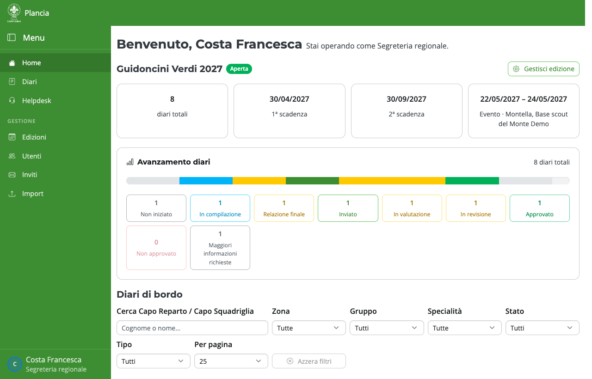

---

## Edizioni

**Edizioni** elenca le edizioni (bozza, aperta, in valutazione, chiusa) con scadenze e date
dell'evento; ogni scheda ha **Apri** e **Modifica**. **Nuova edizione** crea un'edizione.

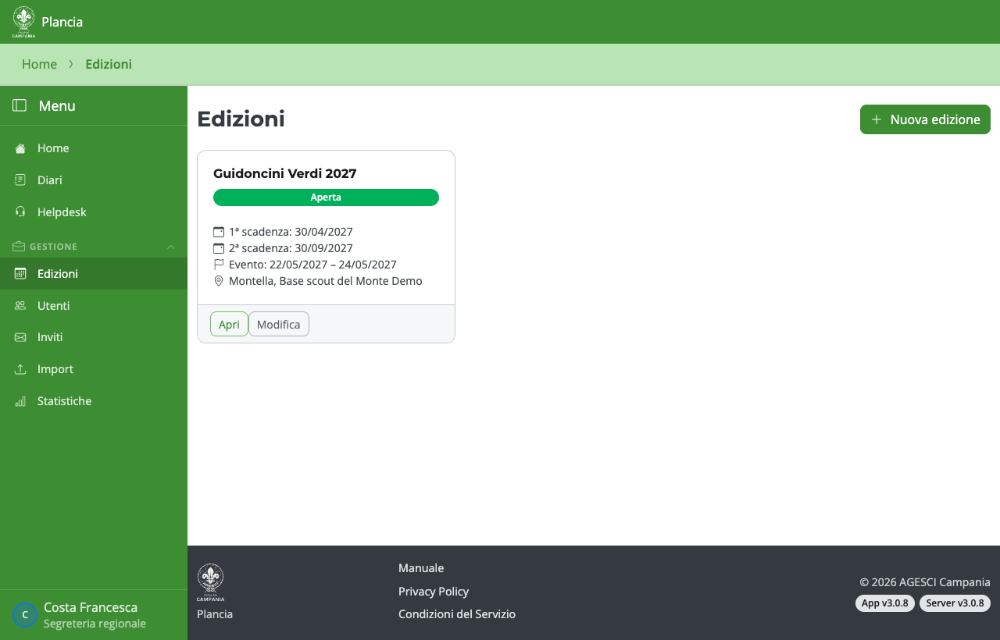

Nel modulo dell'edizione: **Anno**, **Stato**, **1ª scadenza (evento)**, **2ª scadenza
(assemblea)**, **Inizio evento**, **Fine evento**, **Comune** (con suggerimenti) e **Località**;
poi **Salva edizione**.

### Dettaglio dell'edizione

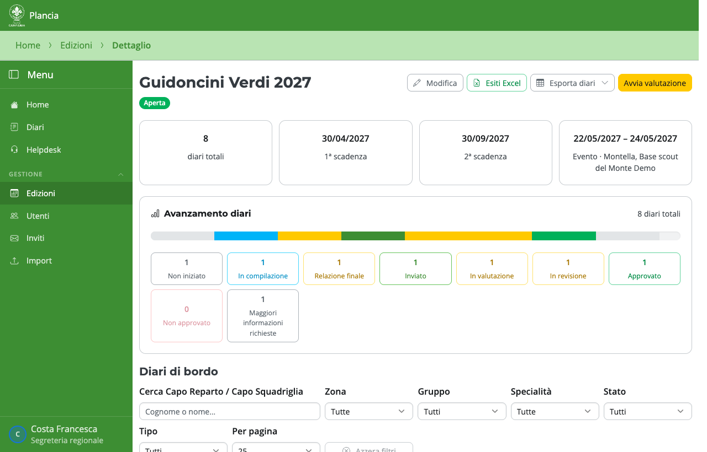

La barra in alto contiene:

- **Modifica**;
- **Esiti Excel**: il file con gli esiti di tutti i diari dell'edizione;
- **Esporta diari** → *Excel (xlsx)*, *Calc (ods)* o *CSV*: un foglio unico con il contenuto di
  tutti i moduli. Con molti diari il file viene preparato in background e arriva per email;
- **Pubblica esiti**, solo per Incaricati EG e Admin (vedi la
  [guida dell'Incaricato EG](incaricato.md#pubblicare-gli-esiti));
- il pulsante del prossimo stato: **Apri edizione** (da bozza: Capi Squadriglia e Capi Reparto
  possono compilare), **Avvia valutazione**, **Chiudi edizione** (non si può annullare).

Sotto: l'**Avanzamento diari** per stato (cliccando un riquadro si filtra la tabella), la tabella
**Diari di bordo** con ricerca e filtri, le **Dilazioni** e il collegamento a **Google Drive**.

### Dilazioni

Nel riquadro **Dilazioni** premi **Concedi dilazione**, scegli il **Diario** (solo quelli non
ancora inviati), la **Nuova scadenza** e la **Motivazione**, poi **Concedi**. La dilazione si può
concedere anche dal diario (**Concedi dilazione** nel riquadro Azioni).

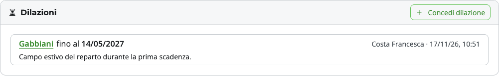

### Google Drive dell'edizione

Gli allegati e i PDF di ogni edizione possono finire in due cartelle Google Drive: **Cartella
Allegati** e **Cartella Output**. Il riquadro **Google Drive** permette di **Connettere un account
Google Drive**, scegliere le cartelle con **Sfoglia** e impostare il **Formato nome cartella
diario** (con anteprima). Al salvataggio di tutti e tre i valori la configurazione viene
**bloccata** e non si può più cambiare. I dettagli sono nella
[guida dell'Amministratore](admin.md#google-drive).

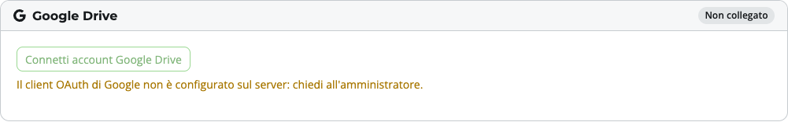

---

## Utenti e nomine

**Utenti** elenca tutti gli account con ricerca (email, nome o cognome) e filtro per ruolo.

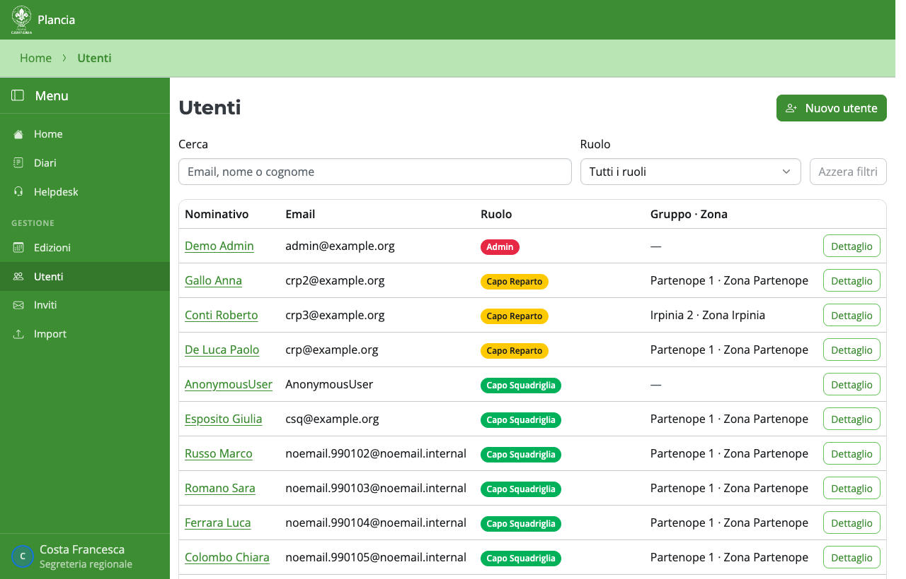

### Nuovo utente

**Nuovo utente** offre due tipi:

- **Utente di staff** (Admin, Segreteria, Incaricato EG): non serve un codice socio. Inserisci
  *Nome*, *Cognome*, *Email* e *Ruolo*, poi **Crea utente e invia l'email**: l'utente riceve il
  link per impostare la password. Se l'email non arriva può usare *Password dimenticata?*.
- **Da Socio importato**: scegli un capo tra i soci importati e il ruolo, poi **Crea account**;
  l'invito si invia poi dalla pagina **Inviti**.

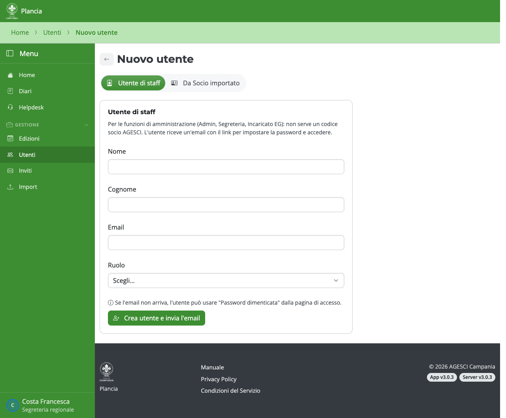

La Segreteria può nominare Incaricati EG, Pattuglia GV, Capi Reparto e Capi Squadriglia; Admin e
Segreteria li nomina solo un Admin.

### Dettaglio utente

Il dettaglio mostra i dati (email, codice socio, categoria, gruppo, zona, ruoli attivi), lo
**Storico nomine** (con **Revoca**: la nomina resta nello storico) e gli **Ultimi accessi**.
Da **Assegna ruolo** scegli *Ruolo*, eventualmente *Edizione* (solo per Capo Reparto e Capo
Squadriglia) e *Scadenza*, poi **Conferma nomina**.

Per gli utenti non collegati a un socio AGESCI (lo staff creato a mano o entrato con l'SSO)
Admin e Segreteria trovano **Modifica nome**, con Nome e Cognome. La Segreteria non può
modificare il nome di chi ha il ruolo Admin.

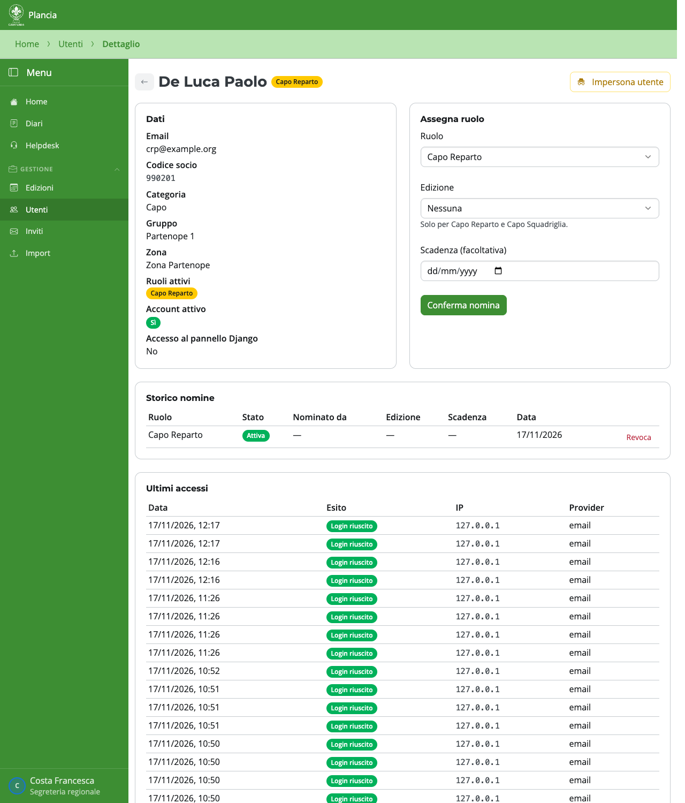

### Impersonare un utente

**Impersona utente** (in alto nel dettaglio) fa vedere Plancia esattamente come la vede
quell'utente, utile per l'assistenza. In cima a ogni pagina compare la fascia *"Stai operando come
…"* con **Torna al tuo account**. La Segreteria non può impersonare chi ha il ruolo Admin; ogni
impersonazione viene registrata.

---

## Inviti

**Inviti** (sezione Gestione) mostra l'edizione attiva con due riquadri, **Capi Reparto** e
**Capi Squadriglia**: *Totale*, *Da invitare*, *Invitati*, *Attivati*, il **Canale di invio**
(predefinito o email di sistema) e il pulsante di invio.

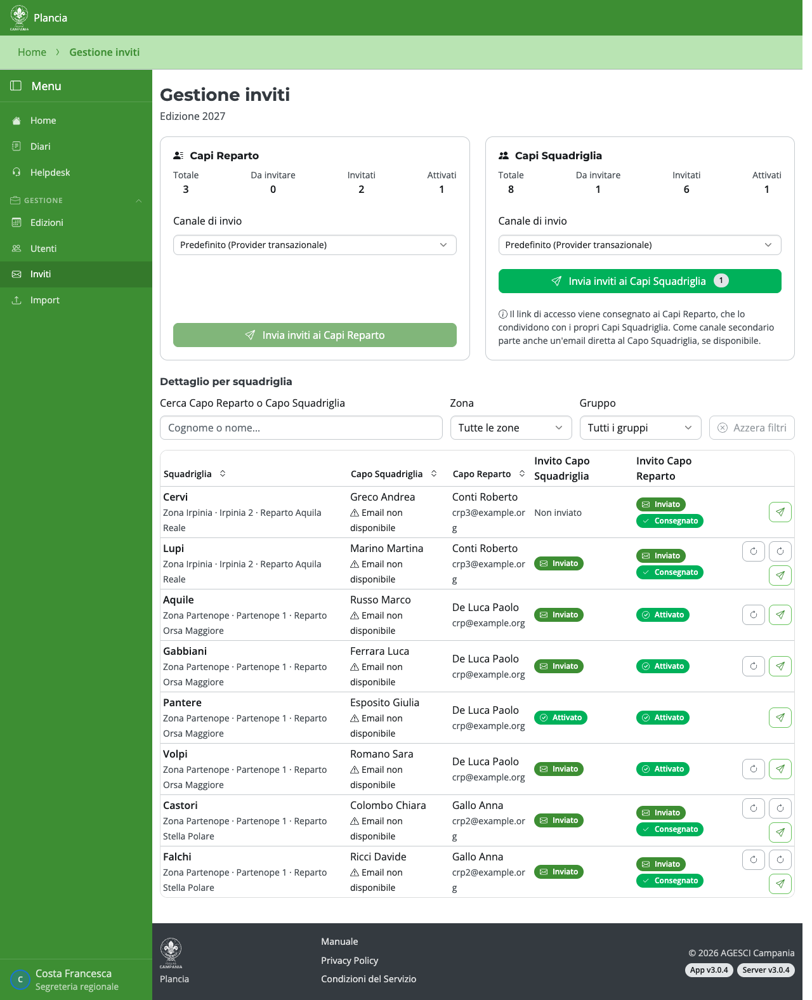

### Sequenza consigliata

1. Esegui gli import (Capi → Squadriglie iscritte) e risolvi le anomalie.
2. **Invia inviti ai Capi Reparto**: ogni Capo Reparto riceve il proprio link di attivazione.
3. **Invia inviti ai Capi Squadriglia**: ogni Capo Reparto riceve un'**email riepilogativa** con i
   link dei propri Capi Squadriglia, da consegnare ai ragazzi; se nel tracciato c'è l'email del
   Capo Squadriglia parte anche un'email diretta, come canale secondario.
4. Il Capo Squadriglia attiva l'account confermando **codice socio AGESCI** ed **email**.

### Dettaglio per squadriglia

La tabella in basso (con ricerca e filtri per zona e gruppo) mostra per ogni squadriglia Capo
Squadriglia e Capo Reparto, lo stato dei due inviti (*Non inviato*, *Inviato*, *Attivato*, e
l'esito della consegna se il provider lo comunica) e i pulsanti per **reinviare** un invito (il
link precedente viene invalidato) o **inviare gli inviti mancanti** della squadriglia. I Capi
Reparto creati dall'import come provvisori hanno il badge **Da riconciliare**.

---

## Import

**Import** carica i tracciati e mostra lo storico. L'ordine consigliato è:

| Scheda | File | Cosa fa |
|---|---|---|
| 1. Capi (Co.Ca.) | CSV (export BuonaStrada) | Crea/aggiorna i soci capi; va fatto prima delle squadriglie |
| 2. Squadriglie iscritte | CSV dell'evento (BuonaCaccia), con l'edizione | Crea i diari, i Capi Squadriglia e abbina il Capo Reparto per email |
| 3. Ragazzi *(opzionale)* | CSV (export BuonaStrada) | Aggiorna i dati dei ragazzi tramite codice socio |
| 4. Risposte EG (Jotform) | xlsx | Importa i diari compilati con il Jotform; elaborazione in background, resoconto per email |

Scegli il file (e l'edizione dove richiesto) e premi **Importa …**.

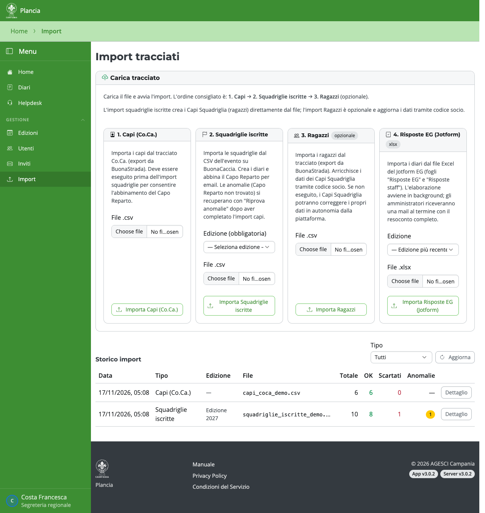

> I file reali contengono dati di minori: non vanno condivisi né conservati fuori dalla
> piattaforma.

### Anomalie e riconciliazione

Lo **Storico import** riporta per ogni caricamento righe totali, OK, scartate e anomalie;
**Dettaglio** apre il resoconto:

- **Anomalie da riconciliare**: di solito un Capo Reparto non trovato per email. In quel caso
  l'import crea un **Capo Reparto provvisorio** (codice socio temporaneo `tmpNNNNN`) così il
  diario ha comunque un referente e può ricevere l'invito. Dopo un nuovo import dei capi premi
  **Riprova anomalie** per abbinarli in automatico; per le righe residue cerca il socio capo
  (nome, cognome, gruppo, zona o codice socio) e premi **Associa**. Se il provvisorio aveva già
  attivato l'account, l'account passa al socio reale senza perdere dati.
- **Righe scartate**: le righe escluse con il motivo dell'errore; **Scarica CSV** per correggerle.

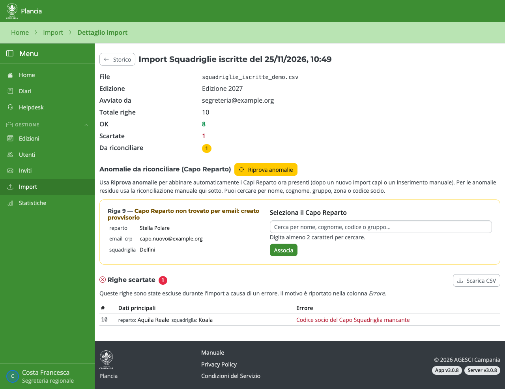

---

## Cambio dei referenti

### Capo Squadriglia o Capo Reparto di un diario

Dal diario, nel riquadro Azioni, **Cambia Capo Squadriglia** o **Cambia Capo Reparto**: cerca il
nuovo referente (almeno 2 caratteri) e premi **Conferma cambio**. Lo staff può farlo finché il
diario non è stato inviato (stati *Non iniziato*, *In compilazione*, *Relazione finale*).

### Capo Reparto di tutto il reparto

Quando un Capo Reparto viene sostituito su tutte le squadriglie, dal diario premi **Cambia il Capo
Reparto di tutto il reparto**. La pagina elenca i **Diari coinvolti** (solo quelli non ancora
inviati); scegli il **Nuovo Capo Reparto** e premi **Conferma cambio per tutti i diari**.

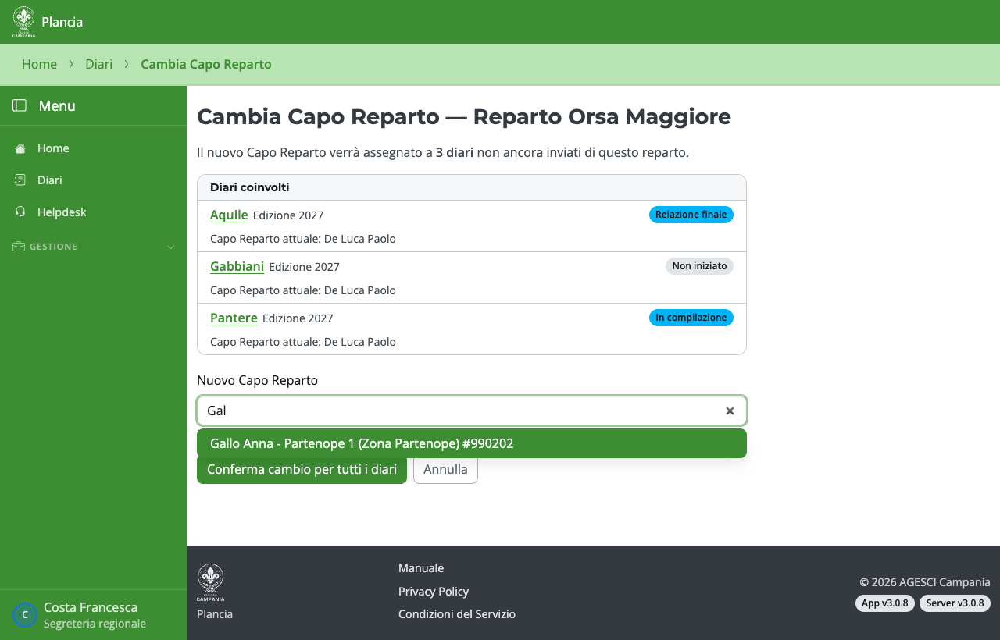

I diari già inviati non vengono toccati: per quelli serve un intervento dell'Admin.

---

## Helpdesk

**Helpdesk** mostra tutte le richieste di assistenza, filtrabili per stato.

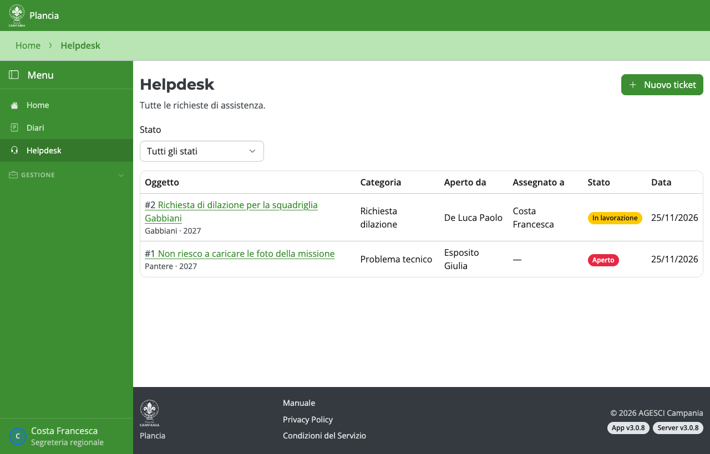

Nel ticket trovi la richiesta (chi l'ha aperta, categoria, diario collegato) e le risposte.
Scrivi nella **La tua risposta** e premi **Rispondi**; **Prendi in carico** assegna il ticket a
te, **Chiudi ticket** lo chiude.

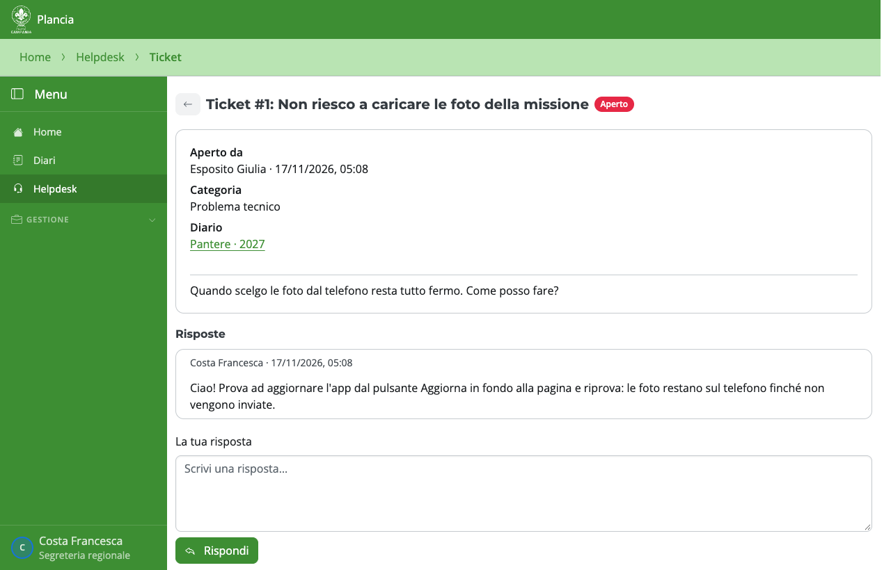
